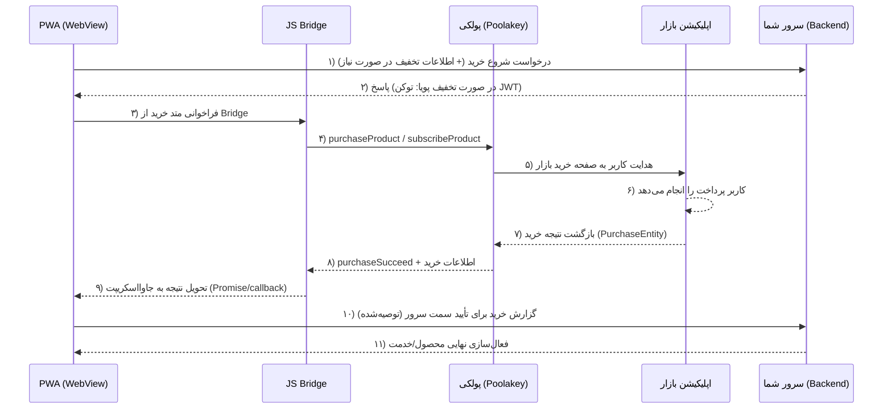
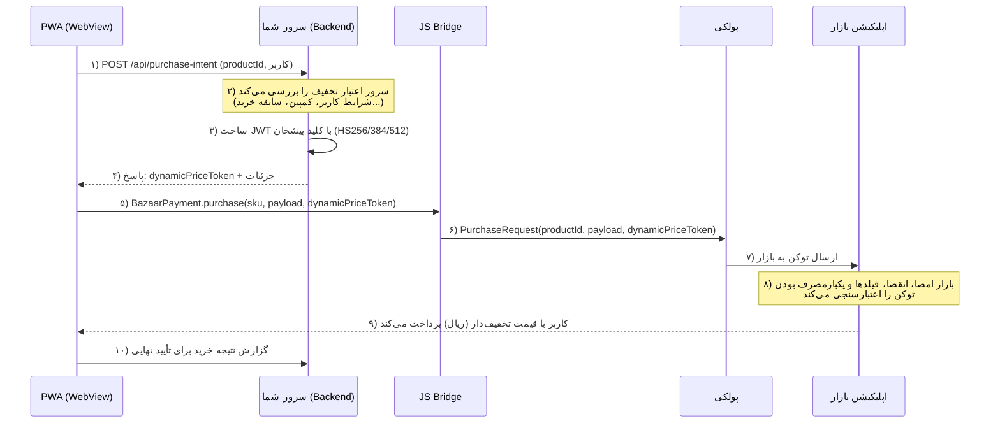
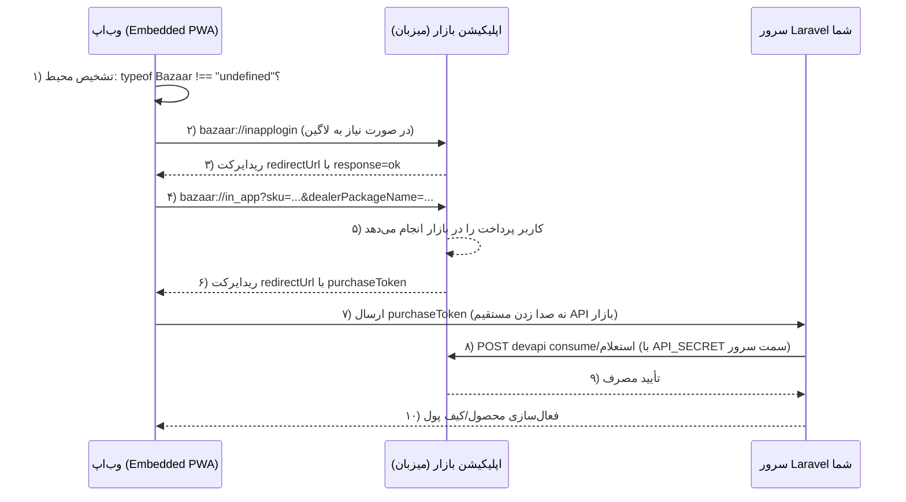

# مستندات پیاده‌سازی پرداخت کافه‌بازار در حالت PWA / وب

> **درباره این سند:** این مستندات بر پایه مستندات رسمی پرداخت درون‌برنامه‌ای کافه‌بازار (کتابخانه پولکی، پولکی ری‌اکت‌نیتیو و قابلیت تخفیف پویا) بازنویسی و برای سناریوی **PWA / وب** تنظیم شده است. تمرکز ویژه این سند روی قابلیت **تخفیف پویا (Dynamic Pricing)** برای فروش محصولات با قیمت‌های دلخواه است. بخش‌های مستقیماً نقل‌شده از مستندات رسمی بازار با نشانگر 📄 مشخص شده‌اند و نمونه‌کدهای مربوط به پل ارتباطی وب (JS Bridge) راهکار عملی پیاده‌سازی برای حالت PWA هستند.
>
> **به‌روزرسانی (بر اساس ریپازیتوری رسمی `cafebazaar/embedded-pwa`):** پس از بررسی عمیق سورس‌کد رسمی بازار، مشخص شد که در کنار مسیر «پولکی + Bridge سفارشی»، یک **مسیر رسمی دوم** به نام Embedded PWA وجود دارد که کاملاً مبتنی بر دیپ‌لینک‌های `bazaar://` و آبجکت تزریقی `Bazaar` است و نیازی به توسعه پوسته اندرویدی ندارد. جزئیات کامل این مسیر در **بخش ۱۱** و فهرست منابع در **بخش ۱۲** آمده است. بخش‌های ۱، ۳، ۶، ۷، ۹ و ۱۰ نیز متناسب با این یافته به‌روزرسانی شده‌اند.

---

## فهرست مطالب

1. [مقدمه و نکته مهم معماری](#۱-مقدمه-و-نکته-مهم-معماری)
2. [پیش‌نیازها](#۲-پیش‌نیازها)
3. [معماری پرداخت در حالت PWA/وب](#۳-معماری-پرداخت-در-حالت-pwaوب)
4. [پیاده‌سازی پل ارتباطی (JS Bridge)](#۴-پیاده‌سازی-پل-ارتباطی-js-bridge)
5. [جریان خرید: محصول، اشتراک، مصرف و استعلام](#۵-جریان-خرید-محصول-اشتراک-مصرف-و-استعلام)
6. [تخفیف پویا — فروش محصولات با قیمت دلخواه ⭐](#۶-تخفیف-پویا--فروش-محصولات-با-قیمت-دلخواه-)
7. [تأیید پرداخت در سمت سرور](#۷-تأیید-پرداخت-در-سمت-سرور)
8. [عیب‌یابی](#۸-عیب‌یابی)
9. [سوالات متداول](#۹-سوالات-متداول)
10. [چک‌لیست نهایی پیاده‌سازی](#۱۰-چک‌لیست-نهایی-پیاده‌سازی)
11. [معماری رسمی Embedded PWA بازار — مسیر دیپ‌لینک (یافته‌های ریپازیتوری رسمی)](#۱۱-معماری-رسمی-embedded-pwa-بازار--مسیر-دیپ‌لینک-یافته‌های-ریپازیتوری-رسمی)
12. [منابع و شواهد](#۱۲-منابع-و-شواهد)

---

## ۱. مقدمه و نکته مهم معماری

سیستم پرداخت درون‌برنامه‌ای (In-App Billing) کافه‌بازار بر این اساس طراحی شده است که **برنامه شما مستقیماً با اپلیکیشن بازار صحبت کند** تا عملیات خرید انجام شود. به همین دلیل، کتابخانه رسمی پرداخت بازار یعنی **پولکی** (Poolakey) که با زبان Kotlin توسعه یافته، فقط در محیط اندروید و با نصب بودن اپلیکیشن بازار روی دستگاه کاربر کار می‌کند.

این نکته برای حالت PWA/وب یک پیامد معماری مهم دارد:

| سناریو | امکان پرداخت بازار | راهکار |
| --- | --- | --- |
| **PWA داخل پوسته اندرویدی (WebView/TWA) منتشرشده در بازار، با نصب بودن اپ بازار** | ✅ بله | پل ارتباطی JavaScript (JS Bridge) بین PWA و پولکی — موضوع اصلی این سند |
| **Embedded PWA: وب‌اپ اجراشده در WebView خود اپلیکیشن بازار** | ✅ بله | دیپ‌لینک‌های `bazaar://inapplogin` و `bazaar://in_app` + آبجکت تزریقی `Bazaar` — بدون نیاز به پوسته اندرویدی (بخش ۱۱) |
| **React Native / Cross-platform** | ✅ بله | کتابخانه رسمی «پولکی ری‌اکت‌نیتیو» (بخش ۵.۴) |
| **PWA خالص در مرورگر (بدون اپ بازار روی دستگاه)** | ❌ خیر | پرداخت درون‌برنامه‌ای بازار در مرورگر پشتیبانی نمی‌شود؛ این سناریو خارج از محدوده مستندات رسمی بازار است |

به بیان ساده: اگر PWA شما قرار است از طریق بازار توزیع و پردازش مالی شود، استانداردترین مسیر، بسته‌بندی (Wrap) کردن PWA در یک پوسته اندرویدی و دسترسی به پولکی از طریق `addJavascriptInterface` است. تمام متدهای پولکی (اتصال، خرید، مصرف، استعلام) از این طریق در جاوااسکریپت PWA شما در دسترس قرار می‌گیرند.

> **مسیر دوم رسمی (مستندشده در بخش ۱۱):** ریپازیتوری رسمی `cafebazaar/embedded-pwa` نشان می‌دهد که بازار یک معماری رسمی مکمل برای وب‌اپلیکیشن‌ها دارد که در آن **خود اپلیکیشن بازار میزبان وب‌اپ است** (Embedded PWA). در این معماری، خرید از طریق دیپ‌لینک `bazaar://in_app` آغاز می‌شود، نتیجه خرید (`purchaseToken`) با ریدایرکت به URL وب‌اپ برگردانده می‌شود و مصرف خرید با REST API سرور بازار انجام می‌شود — بدون هیچ کد اندرویدی از سمت توسعه‌دهنده. محدودیت مهم این مسیر این است که **فیلدی برای توکن تخفیف پویا در دیپ‌لینک پرداخت وجود ندارد** و تخفیف پویا همچنان فقط از مسیر پولکی قابل استفاده است (بخش ۶.۸).

> **خبر خوب در مورد تخفیف پویا:** طبق مستندات رسمی، **ساخت توکن تخفیف پویا (JWT) باید حتماً در سرور شما انجام شود** — نه در اپلیکیشن. این یعنی مهم‌ترین و حساس‌ترین بخش پیاده‌سازی تخفیف پویا در معماری وب/PWA به‌طور طبیعی و بدون هیچ تغییری در سمت سرور (Node.js، Python، PHP و...) قابل پیاده‌سازی است و فقط ارسال نهایی توکن به پولکی از طریق پل انجام می‌شود.

---

## ۲. پیش‌نیازها

قبل از شروع پیاده‌سازی، این موارد را آماده کنید:

1. **حساب توسعه‌دهنده در پیشخان بازار** — وارد [پیشخان توسعه‌دهندگان بازار](https://pishkhan.cafebazaar.ir/) شوید و برنامه خود را ثبت کنید.
2. **کلید RSA عمومی برنامه** — در صفحه اطلاعات برنامه، وارد تب «پرداخت درون‌برنامه‌ای» شوید و کلید RSA را کپی کنید. این کلید برای اعتبارسنجی امنیتی خریدها در پولکی لازم است.
3. **تعریف محصولات (SKU)** — در همان تب «پرداخت درون‌برنامه‌ای»، محصولات خود را با شناسه یکتا (PRODUCT_ID / sku) تعریف کنید. توجه کنید که برای استفاده از تخفیف پویا، قیمت محصول در پنل، **سقف قیمت** فروش محسوب می‌شود.
4. **کلید امضای توکن تخفیف پویا** — اگر قصد استفاده از تخفیف پویا را دارید، کلید امضای JWT را از پیشخان برنامه دریافت کنید (بخش ۶).
5. **نصب بودن اپلیکیشن بازار روی دستگاه کاربر** — پرداخت درون‌برنامه‌ای به نصب بودن اپ بازار نیاز دارد.
6. **برای تخفیف پویا: نسخه ۱۳.۳.۰ بازار یا بالاتر** — اگر نسخه بازار کاربر قدیمی‌تر باشد، کاربر خطای `dynamic price not supported` دریافت می‌کند.
7. **پوسته اندرویدی برای PWA** — یک اپ اندرویدی حاوی WebView که PWA شما را بارگذاری می‌کند و کتابخانه پولکی را در خود دارد.

---

## ۳. معماری پرداخت در حالت PWA/وب

جریان کامل پرداخت در حالت PWA به این شکل است:



نکات کلیدی معماری:

- **دو مسیر رسمی برای وب/PWA:** نمودار بالا جریان مسیر «پولکی + Bridge سفارشی» را نشان می‌دهد. مسیر رسمی دوم یعنی «دیپ‌لینک Embedded PWA» (WebView میزبان = خود بازار) جریان متفاوتی دارد که در بخش ۱۱ با نمودار اختصاصی آمده است.
- **اتصال قبل از خرید:** برنامه شما باید ابتدا با بازار «متصل» شود (متد `connect`) و پس از پایان کار، اتصال را قطع کند (`disconnect`) تا از مشکلاتی مانند Memory Leak جلوگیری شود. این نکته فقط مربوط به مسیر پولکی است؛ در مسیر دیپ‌لینک مفهوم connect/disconnect وجود ندارد.
- **ورود کاربر:** برای برخی عملیات (مصرف خرید، استعلام خریدها و اشتراک‌ها) کاربر باید وارد حساب بازار خود باشد؛ در غیر این صورت عملیات با خطا مواجه می‌شود.
- **تأیید سمت سرور:** طبق توصیه رسمی مستندات بازار، پس از هر خرید موفق، بهتر است صحت پرداخت را از طریق API پرداخت بازار در سرور خود نیز بررسی کنید (بخش ۷).

---

## ۴. پیاده‌سازی پل ارتباطی (JS Bridge)

### ۴.۱ سمت اندروید: اضافه کردن پولکی به پروژه پوسته

📄 طبق مستندات رسمی پولکی، برای شروع، کتابخانه پولکی را به پروژه خود در فایل `build.gradle` اضافه کنید:

```groovy
dependencies {
    implementation "com.github.cafebazaar.Poolakey:poolakey:[latest_version]"
}
```

سپس باید jitpack را به فایل `build.gradle` اضافه کنید:

```groovy
repositories {
    google()
    jcenter()
    maven { url 'https://jitpack.io' }
}
```

مطمئن شوید که از آخرین نسخه پولکی استفاده می‌کنید. نسخه‌ها از این آدرس قابل مشاهده است:
`https://github.com/PHELAT/Poolakey/releases`

### ۴.۲ سمت اندروید: ساخت پرداخت و متصل کردن آن به WebView

📄 طبق مستندات رسمی، برای صحبت کردن با بازار ابتدا باید به بازار متصل شوید. برای انجام این کار، وارد فایل `Activity` یا `Fragment` خود شوید و در متد `onCreate` یک نمونه از کلاس `SecurityCheck` درست کنید:

```kotlin
val localSecurityCheck = SecurityCheck.Enable(
    rsaPublicKey = "KEY"
)
```

به جای مقدار `KEY` باید از کلید RSA برنامه خود استفاده کنید (پیشخان → صفحه اطلاعات برنامه → تب «پرداخت درون‌برنامه‌ای»).

در مرحله بعد باید یک نمونه از کلاس `PaymentConfiguration` درست کنید و `localSecurityCheck` را به آن تزریق کنید:

```kotlin
val paymentConfiguration = PaymentConfiguration(
    localSecurityCheck = localSecurityCheck
)
```

و در آخرین مرحله باید یک نمونه از کلاس `Payment` درست کنید:

```kotlin
val payment = Payment(context = this, config = paymentConfiguration)
```

📄 کلاس `Payment` پل ارتباطی بین برنامه شما و بازار است و از این کلاس می‌توانید برای اتصال به بازار، خرید یک محصول و موارد مشابه استفاده کنید.

حالا این `Payment` را از طریق یک Interface در دسترس جاوااسکریپت PWA قرار می‌دهیم:

```kotlin
class BazaarPaymentBridge(
    private val activity: Activity,
    private val payment: Payment,
    private val webView: WebView
) {

    /**
     * اتصال به بازار — از JS: BazaarPayment.connect()
     */
    @JavascriptInterface
    fun connect(callbackId: String) {
        activity.runOnUiThread {
            payment.connect {
                connectionSucceed {
                    notifyJs(callbackId, successJson())
                }
                connectionFailed { throwable ->
                    notifyJs(callbackId, errorJson(throwable))
                }
                disconnected { /* قطع اتصال؛ در صورت نیاز به JS اطلاع دهید */ }
            }
        }
    }

    /**
     * خرید محصول — از JS: BazaarPayment.purchase(productId, payload, dynamicPriceToken)
     * dynamicPriceToken اختیاری است و فقط برای تخفیف پویا ارسال می‌شود (بخش ۶)
     */
    @JavascriptInterface
    fun purchase(productId: String, payload: String, dynamicPriceToken: String?, callbackId: String) {
        activity.runOnUiThread {
            val request = if (dynamicPriceToken != null) {
                PurchaseRequest(
                    productId = productId,
                    payload = payload,
                    dynamicPriceToken = dynamicPriceToken
                )
            } else {
                PurchaseRequest(
                    productId = productId,
                    payload = payload
                )
            }
            payment.purchaseProduct(
                registry = activity.activityResultRegistry,
                request = request
            ) {
                purchaseFlowBegan { /* فرایند خرید آغاز شد */ }
                failedToBeginFlow { throwable ->
                    notifyJs(callbackId, errorJson(throwable))
                }
                purchaseSucceed { purchaseEntity ->
                    notifyJs(callbackId, purchaseJson(purchaseEntity))
                }
                purchaseCanceled {
                    notifyJs(callbackId, cancelledJson())
                }
                purchaseFailed { throwable ->
                    notifyJs(callbackId, errorJson(throwable))
                }
            }
        }
    }

    private fun notifyJs(callbackId: String, result: String) {
        webView.post {
            webView.evaluateJavascript(
                "window.__bazaarCallback('$callbackId', $result)", null
            )
        }
    }
}
```

و در Activity اصلی، Bridge را به WebView متصل کنید:

```kotlin
webView.settings.javaScriptEnabled = true
webView.addJavascriptInterface(
    BazaarPaymentBridge(this, payment, webView),
    "BazaarPayment"
)
```

> **نکته:** قطع اتصال را فراموش نکنید. 📄 طبق مستندات رسمی، برای جلوگیری از مشکلاتی همچون Memory Leak باید در متد `onDestroy` از Activity یا Fragment خود، اقدام به قطع اتصال با بازار کنید:

```kotlin
override fun onDestroy() {
    paymentConnection.disconnect()
    super.onDestroy()
}
```

### ۴.۳ سمت PWA: wrapper جاوااسکریپت

در سمت PWA یک wrapper ساده می‌نویسیم که همه فراخوانی‌ها را به Promise تبدیل کند:

```javascript
// bazaar-payment.js — wrapper پرداخت بازار برای PWA

let _callbackCounter = 0;
const _pendingCallbacks = new Map();

// این تابع از سمت Bridge (اندروید) صدا زده می‌شود
window.__bazaarCallback = function (callbackId, result) {
    const cb = _pendingCallbacks.get(callbackId);
    if (cb) {
        _pendingCallbacks.delete(callbackId);
        cb(result);
    }
};

function callBridge(method, ...args) {
    if (!window.BazaarPayment) {
        return Promise.reject(
            new Error('پل پرداخت بازار در دسترس نیست (خارج از پوسته اندرویدی هستید)')
        );
    }
    const callbackId = `cb_${Date.now()}_${_callbackCounter++}`;
    return new Promise((resolve, reject) => {
        _pendingCallbacks.set(callbackId, (result) => {
            if (result.status === 'success') resolve(result.data);
            else if (result.status === 'cancelled') reject(new Error('USER_CANCELLED'));
            else reject(new Error(result.message || 'PAYMENT_ERROR'));
        });
        window.BazaarPayment[method](...args, callbackId);
    });
}

export const BazaarPayment = {
    connect: () => callBridge('connect'),
    // purchaseToken فقط برای تخفیف پویا (بخش ۶)
    purchase: (productId, payload = '', dynamicPriceToken = null) =>
        callBridge('purchase', productId, payload, dynamicPriceToken),
};
```

نحوه استفاده در PWA:

```javascript
async function startPurchase(productId) {
    try {
        await BazaarPayment.connect();

        const result = await BazaarPayment.purchase(productId);
        // result شامل purchaseToken و سایر اطلاعات خرید است

        // تأیید سمت سرور (بخش ۷)
        await fetch('/api/verify-bazaar-purchase', {
            method: 'POST',
            headers: { 'Content-Type': 'application/json' },
            body: JSON.stringify(result),
        });

        showSuccess('خرید با موفقیت انجام شد');
    } catch (e) {
        if (e.message === 'USER_CANCELLED') {
            showMessage('خرید لغو شد');
        } else {
            showError(e.message);
        }
    }
}
```

> **نکته امنیتی مهم:** مقدار `payload` (که خودتان تعیین می‌کنید) و توکن تخفیف را همیشه از سرور خودتان دریافت کنید، نه از ورودی مستقیم کاربر در فرانت‌اند. سقف تصمیم‌های مالی (مبلغ، تخفیف) باید همیشه در سرور تعیین شود.

---

## ۵. جریان خرید: محصول، اشتراک، مصرف و استعلام

### ۵.۱ شروع روند خرید یک محصول

📄 برای شروع روند خرید یک محصول، باید ابتدا یک نمونه از کلاس `PurchaseRequest` ساخته شود:

```kotlin
val purchaseRequest = PurchaseRequest(
    productId = "PRODUCT_ID",
    payload = "PAYLOAD"
)
```

به جای مقدار `PRODUCT_ID` باید مقدار شناسه محصولی که قصد خرید آن را دارید را جایگزین کنید. برای دریافت مقدار شناسه محصول مورد نظر، به پیشخان توسعه‌دهندگان مراجعه کنید و در صفحه اطلاعات برنامه، در تب «پرداخت درون‌برنامه‌ای» یک محصول جدید بسازید و شناسه‌ای برای آن در نظر بگیرید؛ یا اینکه می‌توانید شناسه محصول‌هایی که پیش از این ساخته‌اید را جایگزین مقدار `PRODUCT_ID` کنید.

سپس با استفاده از فانکشن `purchaseProduct` از کلاس `Payment` روند خرید محصول مورد نظر را شروع کنید:

```kotlin
payment.purchaseProduct(
    registry = activityResultRegistry,
    request = purchaseRequest
) {
    purchaseFlowBegan { /* ... */ }
    failedToBeginFlow { throwable -> /* ... */ }
    purchaseSucceed { purchaseEntity -> /* ... */ }
    purchaseCanceled { /* ... */ }
    purchaseFailed { throwable -> /* ... */ }
}
```

📄 در بدنه فانکشن `purchaseProduct` به callbackهای زیر دسترسی دارید:

| Callback | زمان فراخوانی |
| --- | --- |
| `purchaseFlowBegan` | وقتی فرایند هدایت کاربر به صفحه خرید بازار به درستی انجام شود |
| `failedToBeginFlow` | وقتی فرایند هدایت کاربر به صفحه خرید بازار به درستی انجام نشود؛ با استفاده از `throwable` می‌توانید مشکل آغاز فرایند را متوجه شوید |
| `purchaseSucceed` | وقتی خرید با موفقیت انجام شود؛ از طریق `purchaseEntity` می‌توانید به اطلاعات خرید دست پیدا کنید. **توجه:** در صورت موفقیت‌آمیز بودن خرید، بسیار پیشنهاد می‌شود که از طریق API پرداخت بازار، خودتان صحت پرداخت را نیز بررسی کنید |
| `purchaseCanceled` | وقتی کاربر از خرید منصرف شود |
| `purchaseFailed` | وقتی مشکلی در خرید وجود داشته باشد (مانند صحت نداشتن اطلاعات خرید)؛ با `throwable` می‌توانید از اشکال به‌وجودآمده مطلع شوید |

### ۵.۲ شروع روند اشتراک یک محصول

📄 برای اشتراک یک محصول، دقیقاً مثل شروع خرید یک محصول عمل کنید و به جای استفاده از فانکشن `purchaseProduct` از فانکشن `subscribeProduct` موجود در کلاس `Payment` استفاده کنید.

### ۵.۳ مصرف کردن خرید کاربر (Consume)

📄 وقتی کاربر یکی از محصولات دیجیتالی برنامه شما را خریداری می‌کند، مالک یک نسخه محصول مورد نظر می‌شود و در صورتی که شما کاربر را مجدداً به صفحه پرداخت هدایت کنید، کاربر نمی‌تواند دوباره خرید خود را انجام دهد و با اطلاعات خرید قبلی به برنامه شما باز می‌گردد (`purchaseSucceed`). اما شما می‌توانید برای محصول مورد نظر خود تاریخ مصرف و یا شرایط خاصی را در نظر بگیرید تا خرید مصرف شود؛ در این صورت کاربر می‌تواند مجدداً خرید خود را انجام دهد.

برای مصرف کردن یک خرید از فانکشن `consumeProduct` موجود در کلاس `Payment` استفاده کنید:

```kotlin
payment.consumeProduct("PURCHASE_TOKEN") {
    consumeSucceed { /* ... */ }
    consumeFailed { throwable -> /* ... */ }
}
```

- `consumeSucceed` — وقتی صدا زده می‌شود که عملیات مصرف کردن خرید با موفقیت انجام شود.
- `consumeFailed` — وقتی عملیات مصرف کردن خرید انجام نشود؛ با استفاده از نمونه `throwable` موجود در این callback می‌توانید متوجه مشکل موجود شوید.

📄 به‌جای مقدار `PURCHASE_TOKEN` باید مقدار واقعی توکن خریدی که می‌خواهید مصرف شود را قرار دهید. دسترسی به توکن خرید از طریق کلاس `PurchaseEntity` امکان‌پذیر است؛ وقتی کاربر خرید انجام می‌دهد، پولکی به شما یک `PurchaseEntity` در `purchaseSucceed` می‌دهد. همچنین می‌توانید تمام خریدهای کاربر را از طریق فانکشن `getPurchasedProducts` به دست بیاورید که در این صورت، پولکی لیستی از `PurchaseEntity` می‌دهد که از این طریق نیز می‌توان به توکن خرید دسترسی پیدا کرد.

> ⚠️ **توجه:** محصولات اشتراکی را نمی‌توانید مصرف کنید.
>
> ⚠️ **توجه:** قبل از کار با `consumeProduct` باید مطمئن شوید که کاربر وارد حساب بازار خود شده است؛ در غیر این صورت `consumeFailed` صدا زده می‌شود.

### ۵.۴ دریافت خریدها و اشتراک‌های کاربر

📄 **دریافت خریدهای کاربر** — با استفاده از فانکشن `getPurchasedProducts` از خریدهای کاربر که در برنامه شما انجام داده است، مطلع شوید:

```kotlin
payment.getPurchasedProducts {
    querySucceed { purchasedProducts -> /* لیستی از PurchaseInfo */ }
    queryFailed { throwable -> /* ... */ }
}
```

- `querySucceed` — وقتی ارتباط با بازار به خوبی برقرار شود و مشکلی در دریافت لیست خریدها وجود نداشته باشد؛ با استفاده از `purchasedProducts` (لیستی از `PurchaseInfo`) می‌توانید به خریدهای کاربر دسترسی پیدا کنید.
- `queryFailed` — وقتی ارتباط با بازار برقرار نشود یا مشکلی در دریافت لیست خریدها وجود داشته باشد.

📄 **دریافت اشتراک‌های کاربر** — با استفاده از فانکشن `getSubscribedProducts` از محصولاتی که کاربر اشتراک آن‌ها را در برنامه شما خریداری کرده، مطلع شوید:

```kotlin
payment.getSubscribedProducts {
    querySucceed { purchasedProducts -> /* لیستی از PurchaseInfo */ }
    queryFailed { throwable -> /* ... */ }
}
```

> ⚠️ **توجه:** قبل از کار با `getPurchasedProducts` و `getSubscribedProducts` باید مطمئن شوید که کاربر وارد حساب بازار خود شده است؛ در غیر این صورت `queryFailed` صدا زده می‌شود.

### ۵.۵ بررسی وضعیت اشتراک آزمایشی

📄 شما می‌توانید با استفاده از فانکشن `checkTrialSubscription` موجود در کلاس `Payment` از وضعیت امکان تعلق اشتراک آزمایشی به کاربر در برنامه خود مطلع شوید:

```kotlin
payment.checkTrialSubscription {
    checkTrialSubscriptionSucceed { trialSubscriptionInfo ->
        // ...
    }
    checkTrialSubscriptionFailed { throwable ->
        // ...
    }
}
```

- `checkTrialSubscriptionSucceed` — با استفاده از `trialSubscriptionInfo` می‌توانید به وضعیت امکان تعلق اشتراک آزمایشی کاربر دسترسی پیدا کنید. این آبجکت شامل فیلدهای زیر است:
  - `isAvailable`: در صورت فعال بودن (`true`) نشانگر این است که در صورت خرید اشتراک توسط کاربر، اشتراک آزمایشی به جای اشتراک خریداری‌شده برای او فعال خواهد شد و پس از اتمام اشتراک آزمایشی، با اشتراک اول تمدید خواهد شد.
  - `trialPeriodDays`: طول اشتراک آزمایشی که به کاربر تعلق خواهد گرفت.
- `checkTrialSubscriptionFailed` — وقتی ارتباط با بازار برقرار نشود یا مشکلی در دریافت وضعیت اشتراک آزمایشی وجود داشته باشد.

> ⚠️ **نکات مهم:** قبل از کار با `checkTrialSubscription` باید مطمئن شوید که کاربر وارد حساب بازار خود شده است؛ در غیر این صورت `checkTrialSubscriptionFailed` صدا زده می‌شود. برای بررسی وضعیت اشتراک کاربر پس از فعال‌سازی اشتراک آزمایشی می‌توانید از قسمت «دریافت اشتراک‌های کاربر در برنامه شما» استفاده کنید.

### ۵.۶ گزینه جایگزین: پولکی ری‌اکت‌نیتیو

اگر به جای PWA داخل WebView از **React Native** استفاده می‌کنید، بازار کتابخانه رسمی «پولکی ری‌اکت‌نیتیو» را ارائه کرده است که با زیرساخت پولکی (Kotlin) پیاده‌سازی شده است:

**نصب:**

```bash
yarn add @cafebazaar/react-native-poolakey
# یا
npm install @cafebazaar/react-native-poolakey
```

**اتصال به بازار (دو روش):**

```javascript
// روش ۱: استفاده از هوک useBazaar
import { useBazaar } from '@cafebazaar/react-native-poolakey';
// ...
function MyComponent() {
  const bazaar = useBazaar(RSA_PUBLIC_KEY);
}
```

```javascript
// روش ۲: اتصال دستی در componentDidMount
import bazaar from '@cafebazaar/react-native-poolakey';
// ...
class MyComponent {
  componentDidMount() {
    bazaar
      .connect(RSA_PUBLIC_KEY)
      .catch(handleError); // bazaar is not installed or what?!
  }
}
```

- به جای مقدار `RSA_PUBLIC_KEY` باید از کلید RSA برنامه خود استفاده کنید (پیشخان → صفحه اطلاعات برنامه → تب «پرداخت درون‌برنامه‌ای»).
- آبجکت `bazaar` پل ارتباطی بین برنامه شما و بازار است.

**متدهای اصلی (Promise-based):**

| متد | امضا | توضیحات |
| --- | --- | --- |
| خرید محصول | `bazaar.purchaseProduct("PRODUCT_ID")` | مقدار بازگشتی `Promise<PurchaseResult>` است |
| اشتراک محصول | `bazaar.subscribeProduct("PRODUCT_ID")` | مشابه خرید، اما برای اشتراک |
| مصرف خرید | `consumeProduct(PURCHASE_TOKEN: string): Promise<void>` | توکن خرید از `PurchaseResult` قابل دسترسی است |
| دریافت خریدها | `getPurchasedProducts(): Promise<PurchaseResult[]>` | لیست خریدهای کاربر |
| دریافت اشتراک‌ها | `getSubscribedProducts(): Promise<PurchaseResult[]>` | لیست اشتراک‌های کاربر |
| جزئیات محصولات | `getInAppSkuDetails(productIds: string[]): Promise<SkuDetails[]>` | ورودی، لیستی از شناسه محصولات است |
| جزئیات محصولات اشتراکی | `getSubscriptionSkuDetails(productIds: string[]): Promise<SkuDetails[]>` | ورودی، لیستی از شناسه محصولات اشتراکی است |

در صورت موفق بودن فرآیند پرداخت می‌توانید اطلاعات پرداخت را در مدل `purchaseResult` دریافت کنید. در صورتی که هرگونه مشکلی در فرآیند پرداخت پیش بیاید، Promise مربوطه reject خواهد شد و خطا به شما برگردانده خواهد شد؛ می‌توانید از ساختار `try-catch` با `async/await` یا متد `catch` روی Promise برای خواندن خطاها استفاده کنید.

> ⚠️ **قطع اتصال:** به ازای هر فراخوانی `connect` در کامپوننت‌های مختلف در نهایت باید دقیقاً یک فراخوانی `disconnect` اتفاق بیفتد؛ در صورتی که تعداد فراخوانی‌های `disconnect` معادل `connect`ها شود، اتصال با بازار کاملاً قطع می‌شود. در صورت استفاده از `useBazaar` نیاز به فراخوانی `disconnect` ندارید:
>
> ```javascript
> componentWillUnmount() {
>     bazaar.disconnect();
> }
> ```
>
> ⚠️ همان‌طور که در بخش‌های قبل اشاره شد، قبل از کار با `consumeProduct`، `getPurchasedProducts` و `getSubscribedProducts` باید مطمئن شوید که کاربر وارد حساب بازار خود شده است؛ در غیر این صورت عملیات با خطا مواجه می‌شود.

---

## ۶. تخفیف پویا — فروش محصولات با قیمت دلخواه ⭐

این بخش، قلب این سند است و **تمام جزئیات مستندات رسمی تخفیف پویا** را پوشش می‌دهد.

### ۶.۱ مفهوم و کاربردها

📄 با توجه به نیاز توسعه‌دهندگان بازار به فروش یک محصول به کاربران با قیمت‌های متفاوت (به دلیل تخفیف یا دلایل دیگر)، امکانی به نام **تخفیف پویا** فراهم شده است. با استفاده از این امکان می‌توانید یک محصول (SKU) را با تخفیف بفروشید و دیگر نیازی به تعریف SKUهای مختلف که صرفاً قیمت آنها متفاوت است اما در اصل یک محصول هستند، ندارید.

کاربردهای اصلی:

- فروش یک محصول واحد با **قیمت‌های دلخواه و متفاوت** برای کاربران مختلف (کمپین‌های شخصی‌سازی‌شده)
- اعمال تخفیف روی محصولات معمولی و **محصولات اشتراکی**
- حذف نیاز به ساخت و مدیریت چندین SKU تکراری فقط برای قیمت‌های مختلف

📄 **رفتار تخفیف پویا روی محصولات اشتراکی:** کاربر صرفاً در همان خرید، محصول را با قیمت تخفیف‌دار می‌خرد؛ اما **تمدید خودکار اشتراک با قیمت بدون تخفیف** که همان قیمت ثبت‌شده برای محصول در پنل پیشخان است، صورت خواهد گرفت.

### ۶.۲ مکانیسم کلی: توکن یکبارمصرف JWT

📄 بدین منظور، می‌توانید در شروع روال خرید، یک توکن یکبارمصرف [JWT](https://jwt.io/) بسازید و استفاده کنید. برای ساخت این توکن، مجاز به استفاده از الگوریتم‌های `HS256`، `HS384` و `HS512` برای امضای توکن هستید. **کلید این امضا در پیشخان برنامه شما قابل مشاهده است.**

📄 **تخفیف پویا فقط با کتابخانه پولکی قابل استفاده است.** پس از ساخت توکن، برای ارسال این مقدار به بازار می‌توانید از فیلد `dynamicPriceToken` در کلاس `PurchaseRequest` استفاده کنید.

> ⚠️ **نکته حیاتی امنیتی (از مستندات رسمی):** ساخت توکن باید در **سرور شما** انجام شود؛ چرا که ذخیره‌سازی کلید به هر نحوی در اپلیکیشن شما، بدون شک منجر به افشای کلید شما خواهد شد و بازار هیچ مسئولیتی در قبال سوءاستفاده‌های احتمالی نخواهد داشت. همچنین توجه داشته باشید که **تنها راه revoke کردن یک توکن، revoke کردن کلیدی است که توکن‌ها با آن امضا شده‌اند** و این کار منجر به revoke شدن تمامی توکن‌ها می‌شود.

### ۶.۳ معماری تخفیف پویا در حالت PWA/وب

همان‌طور که گفته شد، ساخت JWT باید سمت سرور باشد و این دقیقاً با معماری وب/PWA سازگار است. جریان کامل به این شکل است:



نکات کلیدی این معماری در حالت وب/PWA:

1. **قیمت نهایی (ریال) را سرور تعیین می‌کند** — فرانت‌اند هیچ اختیاری روی مبلغ ندارد؛ فقط توکن تولیدشده توسط سرور شما را به پولکی می‌رساند.
2. **کلید امضا هرگز به کلاینت نمی‌رسد** — نه در PWA و نه در پوسته اندرویدی.
3. **توکن یکبارمصرف است** — بازار اجازه استفاده مجدد از یک توکن را نمی‌دهد (خطای ۱۱).
4. **اعتبارسنجی نهایی در سمت بازار انجام می‌شود** — بازار امضا، انقضا، همخوانی `account_id` و سقف قیمت را بررسی می‌کند و در صورت مشکل، کد خطا برمی‌گرداند (بخش ۶.۷).

### ۶.۴ محتوای توکن (Payload)

📄 Payload توکن شما باید مطابق جدول زیر باشد:

| نام فیلد | نوع مقدار | اجباری؟ | توضیحات |
| --- | --- | --- | --- |
| `price` | عددی | بله | قیمتی که کاربر باید به **ریال** پرداخت کند. دقت داشته باشید که مقدار فیلد `price` **نمی‌تواند بیشتر از قیمتی باشد** که در پنل پیشخان برای آن محصول (SKU) ثبت کرده‌اید. |
| `package_name` | متنی | بله | پکیج‌نیم اپلیکیشن شما |
| `sku` | متنی | بله | شناسه‌ی کالا |
| `exp` | عددی | بله | زمان انقضای توکن، در قالب UTC UNIX Timestamp |
| `account_id` | متنی | خیر | شناسه‌ی یکتای حساب کاربر در بازار (account id). برای داشتن account id، شما باید **ورود با بازار** را پیاده کرده باشید. |
| `nonce` | متنی | خیر | یک رشته‌ی یکتا به منظور اطمینان از عدم تولید توکن تکراری. به دلیل یکبارمصرف بودن توکن‌ها، اگر تعداد زیادی توکن با پارامترهای یکسان تولید می‌کنید، توسط این فیلد می‌توانید توکن‌های یکتا داشته باشید. محتوای این فیلد نادیده گرفته می‌شود و صرفاً برای یکتایی توکن است. |

جمع‌بندی سریع فیلدها:

- **اجباری:** `price`، `package_name`، `sku`، `exp`
- **اختیاری:** `account_id` (محدود کردن تخفیف به یک کاربر مشخص)، `nonce` (یکتایی توکن)

### ۶.۵ ساخت توکن در سرور (نمونه کدها)

📄 **نمونه رسمی مستندات بازار — ساخت JWT در پایتون، با ذکر تمامی فیلدها:**

```python
import jwt

token = jwt.encode(
    {
        "price": 10000,
        "package_name": "my.wonderful.app",
        "sku": "premium_stuff",
        "exp": expiration_time.timestamp(),
        "nonce": random_stuff(),
        "account_id": "b97d9d79-1f69-486d-9d9d-4a4c9b7e1976",
    },
    "dynamic price key in pishkhan",
    algorithm="HS256",
)
```

> 📄 کتابخانه‌های مرجع مستندات رسمی:
> - [معرفی و ساختار JWT](https://jwt.io/introduction)
> - [کتابخانه پایتون استفاده‌شده در مثال مستندات (PyJWT)](https://pyjwt.readthedocs.io/en/stable/)
> - [کتابخانه ساخت JWT برای سایر زبان‌ها](https://jwt.io/libraries)

**نمونه پیاده‌سازی سمت سرور برای PWA/وب — Node.js:**

```javascript
// Node.js — با کتابخانه jsonwebtoken
const jwt = require('jsonwebtoken');
const crypto = require('crypto');

function createDynamicPriceToken({ price, sku, packageName, accountId, ttlSeconds = 600 }) {
    if (price <= 0) throw new Error('قیمت نامعتبر است');

    return jwt.sign(
        {
            price,                       // قیمت نهایی به ریال (<= قیمت SKU در پیشخان)
            package_name: packageName,   // پکیج‌نیم اپلیکیشن شما
            sku,                         // شناسه کالا
            nonce: crypto.randomUUID(),  // رشته یکتا برای جلوگیری از توکن تکراری
            ...(accountId ? { account_id: accountId } : {}),
        },
        process.env.BAZAAR_DYNAMIC_PRICE_KEY, // کلید دریافت‌شده از پیشخان — فقط سمت سرور
        {
            algorithm: 'HS256',          // HS256 / HS384 / HS512
            expiresIn: ttlSeconds,       // exp توکن (پیشنهاد: کوتاه‌مدت، مثلا ۱۰ دقیقه)
        }
    );
}
```

**نمونه پیاده‌سازی سمت سرور — PHP:**

```php
// PHP — با کتابخانه firebase/php-jwt
use Firebase\JWT\JWT;

function createDynamicPriceToken(array $params): string {
    $issuedAt = time();
    $payload = [
        'price'        => $params['price'],              // ریال؛ نباید بیشتر از قیمت SKU باشد
        'package_name' => $params['package_name'],
        'sku'          => $params['sku'],
        'exp'          => $issuedAt + 600,               // انقضای ۱۰ دقیقه
        'nonce'        => bin2hex(random_bytes(16)),     // یکتایی توکن
    ];
    if (!empty($params['account_id'])) {
        $payload['account_id'] = $params['account_id'];
    }
    return JWT::encode($payload, $_ENV['BAZAAR_DYNAMIC_PRICE_KEY'], 'HS256');
}
```

**نمونه Endpoint سمت سرور برای PWA (Node.js / Express):**

```javascript
app.post('/api/purchase-intent', requireAuth, async (req, res) => {
    const { sku } = req.body;
    const user = req.user; // کاربر لاگین‌شده

    // ۱) قیمت پایه SKU را از دیتابیس خود بخوانید — نه از کلاینت!
    const product = await db.products.findBySku(sku);
    if (!product) return res.status(404).json({ error: 'PRODUCT_NOT_FOUND' });

    // ۲) منطق تجاری تخفیف (کمپین، کاربر وفادار، استفاده نشدن قبلی تخفیف و...)
    const discount = await computeDiscount(user, product);
    if (!discount.eligible) {
        return res.json({ dynamicPriceToken: null, price: product.price });
    }

    // ۳) قیمت نهایی به ریال — همیشه <= قیمت پیشخان
    const finalPrice = Math.min(discount.finalPrice, product.price);

    // ۴) تولید توکن یکبارمصرف + ثبت در دیتابیس برای ردیابی
    const token = createDynamicPriceToken({
        price: finalPrice,
        sku,
        packageName: process.env.PACKAGE_NAME,
        accountId: user.bazaarAccountId ?? undefined,
        ttlSeconds: 600,
    });
    await db.discountTokens.create({ nonce: token.nonceRef, user: user.id, sku });

    res.json({ dynamicPriceToken: token, price: finalPrice });
});
```

### ۶.۶ ارسال توکن به بازار از سمت کلاینت

**در پولکی (کاتلین) — داخل پوسته اندرویدی PWA:**

```kotlin
val purchaseRequest = PurchaseRequest(
    productId = "PRODUCT_ID",
    payload = "PAYLOAD",
    dynamicPriceToken = "eyJhbGciOiJIUzI1NiIs..." // توکن ساخته‌شده در سرور شما
)
```

سپس خرید دقیقاً مثل بخش ۵.۱ ادامه می‌یابد؛ تنها تفاوت، ارسال `dynamicPriceToken` در `PurchaseRequest` است. در معماری PWA، این توکن از سرور شما به PWA می‌رسد و از طریق JS Bridge (بخش ۴.۲) به `PurchaseRequest` منتقل می‌شود.

**در پولکی ری‌اکت‌نیتیو:**

متد `purchaseProduct` در نسخه مستندات موجود، امضای ساده `(productId)` دارد. برای استفاده از تخفیف پویا در ری‌اکت‌نیتیو، بررسی کنید که نسخه کتابخانه پارامتر توکن قیمت پویا را پشتیبانی کند؛ در صورت نیاز می‌توانید با افزودن یک متد بومی (Native Module) روی همان زیرساخت پولکی، فیلد `dynamicPriceToken` را به `PurchaseRequest` تزریق کنید. هسته فرآیند (ساخت توکن در سرور و اعتبارسنجی در بازار) در هر دو حالت یکسان است.

### ۶.۷ کدهای خطای تخفیف پویا

📄 تخفیف پویا فقط از **نسخه ۱۳.۳.۰ بازار به بعد** قابل استفاده است و اگر نسخه بازار کاربر قدیمی‌تر باشد، کاربر خطای **`dynamic price not supported`** دریافت خواهد کرد. برای سایر موارد، در صورتی که در روال خرید خطایی رخ دهد، کاربر یک کد خطا دریافت می‌کند که با توجه به جدول زیر قابل تفسیر است:

| کد خطا | مفهوم |
| --- | --- |
| 1 | خطایی در سمت کافه‌بازار رخ داده است. در صورت دریافت این کد، جزئیات خرید، شامل توکن JWT و مشخصات کاربر را به پشتیبانی بازار اعلام کنید. |
| 2 | ساختار توکن ارسال‌شده ایراد دارد. |
| 3 | الگوریتم استفاده‌شده برای امضای توکن پشتیبانی نمی‌شود. |
| 4 | امضای توکن ارسال‌شده دستکاری شده است. |
| 5 | توکن منقضی شده است. |
| 6 | یکی از فیلدهای اجباری توکن ذکر نشده است. |
| 7 | account id ذکرشده در توکن، با حساب بازار کاربر همخوانی ندارد. |
| 8 | محصولی با مشخصات ذکرشده در توکن یافت نشد. |
| 9 | اپلیکیشنی با این package name یافت نشد. |
| 10 | قیمت ذکرشده در توکن، بیش از قیمت محصول است. |
| 11 | توکن قبلاً در یک خرید دیگر استفاده شده است. |
| 12 | قیمت ذکرشده در توکن، نامعتبر است. |
| 13 | تایپ `sku` اشتباه است. |
| 14 | تایپ `package_name` اشتباه است. |
| 15 | تایپ `price` اشتباه است. |
| 16 | یکی از claimهای JWT دارای تایپ اشتباهی است. لطفاً به مستندات JWT مراجعه کنید. |

**نقشه سریع عیب‌یابی بر اساس کد:**

- خطای ساخت/امضا/تایپ → کدهای **2، 3، 4، 13، 14، 15، 16**: فرمت و تایپ claimها را با مستندات JWT تطبیق دهید.
- خطای انقضا/یکبارمصرف بودن → کدهای **5، 11**: مدت `exp` را کوتاه اما منطقی بگیرید و برای هر درخواست خرید، توکن تازه با `nonce` جدید بسازید.
- خطای فیلدها → کدهای **6، 7، 8، 9، 10، 12**: فیلدهای اجباری، `account_id`، `sku`، `package_name` و سقف قیمت را بررسی کنید.
- خطای سمت بازار → کد **1**: جزئیات خرید (توکن JWT و مشخصات کاربر) را به پشتیبانی بازار اعلام کنید.

### ۶.۸ تخفیف پویا و مسیر دیپ‌لینک Embedded PWA ⚠️

دیپ‌لینک پرداخت رسمی بازار (`bazaar://in_app`) که در بخش ۱۱ مستند شده است، فقط پارامترهای `redirectUrl`، `sku` و `dealerPackageName` را می‌پذیرد (منبع: `src/App.tsx` خطوط ۱۰۲–۱۱۰ ریپازیتوری رسمی). **در این دیپ‌لینک هیچ فیلدی برای انتقال `dynamicPriceToken` وجود ندارد** و در نمونه‌کد رسمی نیز هیچ مسیری برای پیوست کردن توکن JWT به جریان خرید دیده نمی‌شود.

نتیجه عملی برای معماری وب/PWA:

- **فروش با قیمت متغیر/تخفیف‌دار از طریق بازار، فقط از مسیر پولکی (بخش‌های ۴ تا ۶) ممکن است** که به پوسته اندرویدی اختصاصی نیاز دارد.
- در مسیر دیپ‌لینک Embedded PWA، قیمت محصول همان قیمت ثبت‌شده SKU در پیشخان است. اگر مدل کسب‌وکار شما نیاز به قیمت‌گذاری متغیر دارد، یا باید از مسیر پولکی استفاده کنید، یا باید برای هر سطح قیمتی یک SKU جداگانه در پیشخان تعریف کنید.
- این نتیجه از «غیاب پارامتر در دیپ‌لینک رسمی» استنباط شده است؛ تا امروز مستندات مکتوب رسمی بازار به‌صراحت درباره وضعیت تخفیف پویا در مسیر دیپ‌لینک اظهارنظر نکرده‌اند. اگر قیمت متغیر در مسیر دیپ‌لینک برای شما حیاتی است، این مورد را مستقیماً از تیم توسعه‌دهندگان بازار استعلام کنید (بخش ۱۱.۹).

### ۶.۹ نکات امنیتی حیاتی

بر اساس مستندات رسمی و سوالات متداول آن، این نکات را جدی بگیرید:

1. **ساخت توکن فقط در سرور** — ذخیره‌سازی کلید در اپلیکیشن (و به همان اندازه در کد فرانت‌اند PWA) منجر به افشای کلید می‌شود و بازار هیچ مسئولیتی در قبال سوءاستفاده نخواهد داشت.
2. **امضای JWT، رمزنگاری نیست** — JWT از نوع «امضاشده» است اما محتوای آن کدگذاری نشده و قابل مشاهده است؛ هر کس که به توکن دسترسی داشته باشد می‌تواند payload را ببیند. اطلاعات حساس (مانند داده‌های کاربر) را در payload توکن قرار ندهید؛ این اطلاعات باید فقط در دیتابیس سرور نگهداری شود.
3. **جلوگیری از Replay Attack:**
   - از فیلد `nonce` به همراه شناسه یکتا و تصادفی در هر توکن استفاده کنید.
   - سرور شما باید هر `nonce` را پس از اولین استفاده ذخیره کند و دیگر اجازه استفاده مجدد از آن توکن را برای خریدهای بعدی ندهد.
   - زمان انقضای کوتاه‌مدتی برای توکن در فیلد `exp` تنظیم کنید.
4. **امنیت کلید امضا:**
   - کلید را در یک مکان امن با دسترسی محدود ذخیره کنید (در محیط‌هایی مانند AWS Secrets Manager یا Google Cloud Secret Manager).
   - کلید را به‌صورت دوره‌ای تغییر دهید و توکن‌های قدیمی را لغو (revoke) کنید.
   - مکانیزم‌هایی برای مانیتورینگ حملات احتمالی و درخواست‌های مخرب بر اساس کلید JWT پیاده‌سازی کنید.
   - در مواردی که تخفیف به کاربران خاص تعلق دارد، از فیلد `account_id` استفاده کنید.
   - در صورت افشای کلید، کلید مربوطه را لغو کنید؛ توجه داشته باشید که این کار منجر به لغو **تمام توکن‌هایی** می‌شود که با آن کلید امضا شده‌اند. برای ادامه کار، کلید جدیدی تعریف کنید و توکن‌های جدید را با آن تولید کنید. خریدهای فعال که قبلاً انجام شده‌اند تحت تأثیر قرار نمی‌گیرند.
5. **سقف قیمت** — مقدار `price` باید کمتر یا مساوی قیمت محصول ثبت‌شده در پنل پیشخان باشد؛ قیمت بیشتر یا غیرمعتبر (مثلاً منفی) باعث خطای ۱۰ و مقدار خارج از قالب عددی باعث خطای ۱۵ می‌شود.

### ۶.۱۰ سناریوهای پیشرفته تخفیف پویا

**الف) تخفیف اختصاصی برای هر کاربر (فقط یک‌بار):**

1. از فیلد `account_id` در payload توکن استفاده کنید؛ این فیلد باید به شناسه یکتای کاربر مرتبط باشد (برای داشتن account id باید «ورود با بازار» را پیاده کرده باشید).
2. در سمت سرور، هنگام تولید توکن بررسی کنید که آیا کاربر پیش‌تر از این تخفیف استفاده کرده است یا خیر.
3. در صورت عدم وجود رکورد در دیتابیس، توکن جدید تولید کنید؛ در غیر این صورت خطای مربوطه را به کاربر نمایش دهید.

**ب) تخفیف برای گروه خاصی از کاربران:**

- از فیلد اختیاری `account_id` استفاده کنید تا توکن را به یک کاربر خاص اختصاص دهید.
- هنگام تولید توکن، سرور بررسی کند که کاربر در آن گروه مشخص قرار دارد (مثلاً بر اساس معیارهای شما، مثل تعداد خریدهای گذشته یا سطح عضویت).

**ج) کمپین‌های زمان‌دار:**

- برای هر کمپین، زمان شروع و پایان مشخصی تعیین کنید.
- در سرور خود بررسی کنید که در بازه زمانی مجاز کمپین باشید؛ سپس توکن را با فیلد `exp` مناسب تولید کنید.
- از فیلد `nonce` برای جلوگیری از تکراری‌شدن توکن‌ها استفاده کنید.

**د) چندین تخفیف با شرایط مختلف برای یک محصول:**

- توکن‌های جداگانه با مقادیر متفاوت برای فیلدهایی مانند `price`، `exp` یا `account_id` تولید کنید.
- برای هر تخفیف، از یک مقدار منحصربه‌فرد در فیلد `nonce` استفاده کنید تا توکن‌ها یکتا باشند.

**هـ) اختلال در پرداخت پس از صدور توکن:**

- توکن JWT یک‌بارمصرف است و اگر پرداخت کامل نشود، توکن باید بازنگری شود.
- اگر تخفیف همچنان معتبر باشد (بر اساس مقدار `exp`)، می‌توانید توکن جدیدی برای کاربر ایجاد کنید و فرآیند خرید را ادامه دهید.

**و) گزارش مالی:**

📄 در فایل فروش توسعه‌دهندگان بازار، اختلاف قیمت ذکرشده در توکن و قیمت محصول، در ستون‌های «تخفیف سهم بازار» و «تخفیف سهم توسعه‌دهنده» ذکر می‌شود.

---

## ۷. تأیید پرداخت در سمت سرور

📄 **API پرداخت بازار چیست؟** API پرداخت بازار به شما این امکان را می‌دهد که صحت پرداخت‌های انجام‌شده در برنامه خود را از سمت سرور تأیید کنید. این فرایند برای افزایش امنیت و جلوگیری از تخلف‌های پرداخت بسیار مفید است.

📄 طبق توصیه رسمی مستندات پولکی: در صورت موفقیت‌آمیز بودن خرید، **بسیار پیشنهاد می‌شود** که از طریق API پرداخت بازار، خودتان صحت پرداخت را نیز بررسی کنید.

جایگاه این مرحله در معماری PWA/وب:

1. پس از `purchaseSucceed` در پل، `PurchaseEntity` (شامل `purchaseToken`) به جاوااسکریپت PWA برگردانده می‌شود.
2. PWA اطلاعات خرید را به Endpoint سرور خود ارسال می‌کند.
3. سرور شما با فراخوانی API پرداخت بازار (با استفاده از access token پیشخان) صحت خرید را استعلام می‌کند.
4. فقط پس از تأیید سمت سرور، محصول/خدمت را برای کاربر فعال کنید.

> **نکته:** هرگز فعال‌سازی محصول را صرفاً به callback سمت کلاینت (`purchaseSucceed` در جاوااسکریپت) وابسته نکنید؛ کلاینت (به‌ویژه در محیط وب) قابل دستکاری است. تصمیم نهایی همیشه باید بر اساس استعلام سرور به سرور باشد.

> **نکته:** از ذخیره‌سازی اطلاعات حساس مانند `PURCHASE_TOKEN` در حافظه محلی (local storage) برنامه خودداری کنید؛ این اطلاعات باید در دیتابیس سرور نگهداری و مدیریت شود.

### ۷.۱ دو سبک احراز هویت REST API بازار (مستند رسمی + یافته ریپازیتوری)

🤔 **سبک اول — OAuth 2.0 (مستند رسمی):** طبق مستندات رسمی Developer API، سرور شما ابتدا در پنل توسعه‌دهندگان یک Client می‌سازد، با آن `access_token` می‌گیرد و این توکن را با هر درخواست ارسال می‌کند. برای استعلام وضعیت خرید، درخواست GET شامل `package name`، `product/subscription id` و `purchase token` است و پاسخ JSON جزئیات خرید را برمی‌گرداند. سهمیه رسمی API روزانه ۵۰٬۰۰۰ فراخوانی به ازای هر توسعه‌دهنده است.

🔍 **سبک دوم — هدر `CAFEBAZAAR-PISHKHAN-API-SECRET` (شواهد ریپازیتوری رسمی):** در نمونه‌کد رسمی `embedded-pwa`، فراخوانی مصرف خرید روی همان دامنه `pardakht.cafebazaar.ir/devapi/v2` با هدر `CAFEBAZAAR-PISHKHAN-API-SECRET` (کلید API دریافتی از پنل پیشخان) انجام می‌شود:

```tsx
// منبع: cafebazaar/embedded-pwa — src/App.tsx خطوط ۶۴ تا ۸۴
async function paymentConsuming() {
    const url = `https://pardakht.cafebazaar.ir/devapi/v2/api/consume/${PACKAGE_NAME}/purchases/`;
    const options = {
        method: "POST",
        headers: {
            "CAFEBAZAAR-PISHKHAN-API-SECRET": API_SECRET,
            "Content-Type": "application/json",
        },
        body: JSON.stringify({ token: token }), // purchaseToken از ریدایرکت پرداخت
    };
    await fetch(url, options);
}
```

این هدر در مستندات مکتوب رسمی بازار توضیح داده نشده است، اما در سورس‌کد رسمی و پروژه‌های عملیاتی Laravel مستقل (استعلام وضعیت اشتراک و اعتبارسنجی خرید) استفاده می‌شود و مقدار آن فرمت JWT دارد و از پنل پیشخان دریافت می‌شود. برای استعلام خرید (بدون مصرف)، الگوی GET معادل روی همان دامنه بر اساس شواهد پروژه‌های عملیاتی چنین است: `GET https://pardakht.cafebazaar.ir/devapi/v2/api/applications/{package_name}/purchases/{product_id}/{purchase_token}` — اما دقیق‌ترین مرجع برای امضای نهایی این Endpoint، منابع رسمی بازار است؛ این الگو صرفاً یافته شواهد ثانویه است و قبل از پیاده‌سازی باید با منابع رسمی/پشتیبانی بازار تأیید شود.

### ۷.۲ هشدار امنیتی: consume سمت کلاینت در نمونه رسمی مبنای پیاده‌سازی عملیاتی نیست ⚠️

در نمونه‌کد رسمی `embedded-pwa`، فراخوانی consume **مستقیماً از جاوااسکریپت مرورگر** و با قرار دادن `API_SECRET` در باندل فرانت‌اند انجام می‌شود (App.tsx خط ۷۲). این کد ماهیت نمایشی دارد (مقادیر `YOUR_..._HERE` در همان فایل) و **هرگز نباید عیناً در عملیات استفاده شود**، چون:

1. هر کسی که باندل جاوااسکریپت PWA را دانلود کند، به `API_SECRET` دسترسی می‌یابد و می‌تواند خریدهای توکن‌دار دیگران را مصرف کند یا API را سوءاستفاده کند.
2. نتیجه consume در نمونه فقط با `response.ok` سنجیده می‌شود؛ هیچ بررسی ساختار پاسخ، مدیریت خطا یا idempotency ندارد.

در معماری عملیاتی (مثلاً Laravel)، جای این فراخوانی سمت سرور است: کلاینت فقط `purchaseToken` را به Endpoint سرور شما می‌فرستد و سرور با نگهداری امن کلید، consume/استعلام را انجام و پس از تأیید، اعتبار را به کاربر اعطا می‌کند (نمودار بخش ۱۱.۷).

---

## ۸. عیب‌یابی

| مشکل | علت احتمالی | راه‌حل |
| --- | --- | --- |
| پیام `dynamic price not supported` | نسخه اپلیکیشن بازار کاربر قدیمی‌تر از ۱۳.۳.۰ است | کاربر باید بازار را به نسخه ۱۳.۳.۰ یا بالاتر به‌روزرسانی کند (بخش ۶.۷) |
| خطای کد ۱ در تخفیف پویا | خطا در سمت کافه‌بازار | جزئیات خرید، شامل توکن JWT و مشخصات کاربر را به پشتیبانی بازار اعلام کنید |
| خطای کد ۵ (توکن منقضی شده) | فاصله زیاد بین ساخت و استفاده از توکن | توکن را درست قبل از شروع خرید و با `exp` کوتاه‌مدت بسازید |
| خطای کد ۷ (عدم همخوانی account id) | `account_id` توکن با حساب بازار کاربر یکی نیست | مطمئن شوید «ورود با بازار» به‌درستی پیاده‌سازی شده و account id درست کاربر را در سرور نگهداری می‌کنید |
| خطای کد ۱۱ (توکن تکراری) | استفاده مجدد از یک توکن | برای هر خرید، توکن جدید با `nonce` جدید بسازید |
| خطای کد ۱۰ (قیمت بیشتر از محصول) | `price` توکن بزرگ‌تر از قیمت SKU در پیشخان | قیمت نهایی را در سرور با `Math.min(finalPrice, panelPrice)` محدود کنید |
| `connectionFailed` در اتصال | اپ بازار نصب نیست یا ارتباط برقرار نمی‌شود | با `throwable` دریافتی دلیل را بررسی کنید؛ نصب بودن بازار را چک کنید |
| `consumeFailed` / `queryFailed` | کاربر وارد حساب بازار خود نشده است | قبل از این عملیات‌ها، ورود کاربر به حساب بازار را مطمئن شوید |
| خرید مجدد ممکن نیست | خرید قبلی مصرف نشده است | برای محصولات مصرف‌شدنی، پس از تحویل، `consumeProduct` را با توکن خرید فراخوانی کنید |
| Memory Leak در پوسته اندرویدی | فراموشی قطع اتصال | در `onDestroy` متد `disconnect` را فراخوانی کنید (در ری‌اکت‌نیتیو: `componentWillUnmount`) |
| خطای `-14` معادل ری‌اکت‌نیتیو: `bazaar is not installed` در connect | بازار نصب نیست یا کلید RSA اشتباه است | نصب بودن بازار و صحت `RSA_PUBLIC_KEY` از پیشخان را بررسی کنید |

---

## ۹. سوالات متداول

**۱. آیا PWA خالص (بدون پوسته اندرویدی) می‌تواند پرداخت درون‌برنامه‌ای بازار داشته باشد؟**
خیر. پرداخت درون‌برنامه‌ای بازار بر مبنای صحبت مستقیم برنامه شما با اپلیکیشن بازار است (از طریق کتابخانه پولکی). برای فعال‌سازی این قابلیت در PWA، باید PWA را داخل یک WebView اندرویدی اجرا کنید و از طریق JS Bridge به پولکی دسترسی داشته باشید.

**۲. تخفیف پویا چیست و چه کاربردی دارد؟**
تخفیف پویا به شما این امکان را می‌دهد که محصولی را با قیمت‌های متفاوت (مثلاً در زمان تخفیف) به کاربران بفروشید، بدون اینکه نیاز باشد چند SKU مختلف با قیمت‌های متفاوت برای آن محصول تعریف کنید. همچنین امکان اعمال تخفیف روی محصولات اشتراکی نیز وجود دارد.

**۳. آیا استفاده از تخفیف پویا روی محصولات اشتراکی امکان‌پذیر است؟**
بله؛ اما توجه داشته باشید که تخفیف فقط روی خرید اولیه اعمال می‌شود. تمدید خودکار اشتراک با قیمت اصلی (قیمت ثبت‌شده در پنل پیشخان) انجام خواهد شد.

**۴. چگونه می‌توان از تخفیف پویا استفاده کرد؟**
لازم است یک توکن JWT با مقادیر موردنظر تولید کنید. این توکن در فیلد `dynamicPriceToken` در کلاس `PurchaseRequest` استفاده می‌شود. دقت کنید که ساخت توکن باید روی سرور شما انجام شود و ذخیره کلید در اپلیکیشن غیرمجاز است.

**۵. چه الگوریتم‌هایی برای امضای توکن مجاز هستند؟**
`HS256`، `HS384` و `HS512`.

**۶. چه فیلدهایی برای ایجاد توکن تخفیف پویا لازم است؟**
فیلدهای اجباری: `price` (قیمت تخفیف‌داده‌شده به ریال، کمتر یا مساوی قیمت ثبت‌شده در پنل)، `package_name` (پکیج‌نیم اپلیکیشن)، `sku` (شناسه محصول)، `exp` (زمان انقضا به صورت Unix Timestamp). فیلدهای اختیاری: `account_id` (شناسه کاربر در بازار) و `nonce` (رشته یکتا برای یکتایی توکن).

**۷. آیا قیمت توکن می‌تواند بیشتر از قیمت ثبت‌شده در پنل باشد؟**
خیر. قیمت ذکرشده در فیلد `price` توکن باید کمتر یا مساوی قیمت ثبت‌شده برای محصول (SKU) در پیشخان باشد.

**۸. اگر یکی از فیلدهای اجباری در JWT ذکر نشود چه می‌شود؟**
کد خطای ۶ بازگردانده می‌شود.

**۹. اگر کلید امضا افشا شود چه باید کرد؟**
کلید مربوطه را لغو (revoke) کنید. توجه داشته باشید که این کار منجر به لغو تمام توکن‌هایی می‌شود که با آن کلید امضا شده‌اند. سپس کلید جدید تعریف کنید.

**۱۰. چگونه می‌توانم چندین تخفیف پویا با شرایط مختلف برای یک محصول تعریف کنم؟**
توکن‌های جداگانه با مقادیر متفاوت برای فیلدهایی مانند `price`، `exp` یا `account_id` تولید کنید. برای محدود کردن تخفیف به کاربران خاص از `account_id` و برای یکتایی توکن‌ها از `nonce` استفاده کنید.

**۱۱. آیا می‌توان از تخفیف پویا برای محصولات فیزیکی استفاده کرد؟**
خیر؛ تخفیف پویا صرفاً برای محصولات دیجیتال (In-App Purchases) که در کتابخانه پولکی پشتیبانی می‌شوند، قابل استفاده است.

**۱۲. چرا نباید اطلاعات حساس در payload توکن ذخیره شود؟**
JWT «امضاشده» است اما محتوای آن کدگذاری نشده و قابل مشاهده است. هر کس که به توکن دسترسی داشته باشد می‌تواند payload را ببیند؛ اطلاعات حساس باید فقط در دیتابیس سرور نگهداری شود.

**۱۳. توکن منقضی یا معیوب چگونه در UI کاربر ظاهر می‌شود؟**
کاربر هنگام خرید یک کد خطا دریافت می‌کند که بر اساس جدول کدهای خطا (بخش ۶.۷) قابل تفسیر است؛ برای مثال کد ۵ به معنای منقضی‌شدن توکن است.

**۱۴. در فایل فروش، تخفیف پویا چگونه حساب می‌شود؟**
اختلاف قیمت ذکرشده در توکن و قیمت محصول، در ستون‌های «تخفیف سهم بازار» و «تخفیف سهم توسعه‌دهنده» فایل فروش توسعه‌دهندگان بازار ذکر می‌شود.

**۱۵. PWA داخل WebView خود بازار (Embedded PWA) چه تفاوتی با PWA داخل پوسته اندرویدی خودم دارد؟**
در پوسته خودتان، شما با پولکی و `addJavascriptInterface` پل می‌سازید و به امکانات کامل پرداخت (شامل تخفیف پویا و اشتراک) دسترسی دارید. در Embedded PWA، میزبان خود بازار است؛ آبجکت `Bazaar` توسط بازار تزریق می‌شود (`getAccountId` و `back`)، خرید با دیپ‌لینک `bazaar://in_app` آغاز و نتیجه با ریدایرکت `purchaseToken` برگردانده می‌شود (بخش ۱۱). توسعه اندرویدی لازم نیست، اما تخفیف پویا و جزئیاتی مثل مدیریت اشتراک در این مسیر اثبات‌نشده است (بخش ۱۱.۹).

**۱۶. در کدام محیط‌های اجرا کدام قابلیت‌ها در دسترس هستند؟**
آبجکت `Bazaar` فقط داخل WebView بازار تعریف می‌شود (تشخیص با `typeof Bazaar !== "undefined"`). دیپ‌لینک‌های `bazaar://` از هر محیطی که بازار روی دستگاه نصب باشد قابل فراخوانی‌اند (Embedded WebView، و به‌طور نظری مرورگر موبایل؛ البته پشتیبانی رسمی از جریان بازگشت به مرورگر مستند نشده — بخش ۱۱.۸). در مرورگر دسکتاپ یا دستگاه بدون بازار، هیچ‌کدام کار نمی‌کنند.

**۱۷. آیا در مسیر دیپ‌لینک می‌توانم قیمت متغیر بفروشم؟**
شواهد موجود می‌گوید خیر؛ دیپ‌لینک `bazaar://in_app` فقط `redirectUrl`، `sku` و `dealerPackageName` می‌گیرد و فیلدی برای توکن تخفیف پویا ندارد (بخش ۶.۸). برای قیمت‌گذاری متغیر از مسیر پولکی استفاده کنید یا SKUهای جداگانه با قیمت‌های ثابت تعریف کنید.

---

## ۱۰. چک‌لیست نهایی پیاده‌سازی

پیش از انتشار، این موارد را بررسی کنید:

**زیرساخت:**
- [ ] کلید RSA برنامه از پیشخان دریافت و در `SecurityCheck.Enable` تنظیم شده است
- [ ] محصولات (SKU) در تب «پرداخت درون‌برنامه‌ای» پیشخان تعریف شده‌اند
- [ ] PWA درون پوسته اندرویدی (WebView) با پل `addJavascriptInterface` سرو می‌شود
- [ ] `connect` قبل از خرید و `disconnect` در `onDestroy` فراخوانی می‌شود

**تخفیف پویا:**
- [ ] کلید امضای توکن از پیشخان دریافت و فقط در سرور (Secret Manager) نگهداری می‌شود
- [ ] ساخت JWT فقط در سرور انجام می‌شود (HS256/HS384/HS512)
- [ ] فیلدهای اجباری (`price`, `package_name`, `sku`, `exp`) همیشه ارسال می‌شوند
- [ ] `price` همیشه به ریال و کمتر یا مساوی قیمت پیشخان است
- [ ] برای هر توکن `nonce` یکتا تولید و در دیتابیس ثبت می‌شود
- [ ] برای تخفیف‌های اختصاصی، `account_id` (با پیاده‌سازی ورود با بازار) استفاده می‌شود
- [ ] `exp` کوتاه‌مدت است و برای کمپین‌ها با بازه زمانی کمپین هماهنگ است
- [ ] جدول کدهای خطای ۱ تا ۱۶ در UI عیب‌یابی پشتیبانی شما پوشش داده شده است
- [ ] حداقل نسخه بازار ۱۳.۳.۰ برای کاربران تخفیف پویا بررسی/اعلان می‌شود

**پس از خرید:**
- [ ] صحت هر خرید موفق با API پرداخت بازار در سرور تأیید می‌شود
- [ ] محصولات مصرف‌شدنی پس از تحویل، مصرف (consume) می‌شوند
- [ ] محصولات اشتراکی مصرف نمی‌شوند و وضعیت آن‌ها با `getSubscribedProducts` پیگیری می‌شود
- [ ] برای اشتراک آزمایشی، وضعیت با `checkTrialSubscription` بررسی می‌شود
- [ ] توکن‌های خرید در سرور نگهداری می‌شوند و در حافظه محلی کلاینت ذخیره نمی‌شوند

**مسیر دیپ‌لینک Embedded PWA (در صورت استفاده از بخش ۱۱):**
- [ ] تشخیص محیط با `typeof Bazaar !== "undefined"` پیاده شده و خارج از میزبان بازار به دیپ‌لینک fallback می‌شود
- [ ] `&` تو در تو در redirectUrl لاگین با `%26` انکود شده است (کامیت 3e0851a رسمی — بخش ۱۱.۳)
- [ ] پارامترهای بازگشتی (`response`، `purchaseToken`، `status`، `sku`) روی سرور اعتبارسنجی می‌شوند، نه صرفاً در کلاینت
- [ ] `purchaseToken` دریافتی از ریدایرکت قبل از اعطای اعتبار، با REST API بازار در سرور consume/استعلام می‌شود
- [ ] `API_SECRET` پیشخان فقط در سرور نگهداری می‌شود و از باندل فرانت‌اند حذف شده است (بخش ۷.۲)
- [ ] برای پرداخت‌های موفق که کاربر به URL برنگشته (قطع شدن بعد از پرداخت)، سازوکار reconcile/استعلام دوره‌ای وجود دارد
- [ ] مدل قیمت‌گذاری شما به قیمت ثابت SKU در مسیر دیپ‌لینک وابسته است یا مسیر پولکی برای قیمت متغیر انتخاب شده است (بخش ۶.۸)

---

## ۱۱. معماری رسمی Embedded PWA بازار — مسیر دیپ‌لینک (یافته‌های ریپازیتوری رسمی)

> **منبع این بخش:** ریپازیتوری رسمی `cafebazaar/embedded-pwa` (بررسی کامل در تاریخ تهیه این سند؛ شاخه `main`، کامیت‌های `a93dbf8` «Initial commit» و `3e0851a` «Fix redirect url in deepLink url»، هر دو مورخ ۱۴۰۴/۰۷/۲۶) به همراه README رسمی آن. تمام قطعه‌کدهای این بخش عیناً از فایل `src/App.tsx` این ریپازیتوری استخراج شده‌اند. هیچ متد یا قابلیتی فرضی اضافه نشده است. موارد استنباطی صریحاً با برچسب «استنباط» مشخص شده‌اند و موارد بدون شواهد کافی در بخش ۱۱.۹ جمع‌بندی شده‌اند.
>
> **نکته درباره سطح اعتبار:** مسیر دیپ‌لینک در مستندات مکتوب رسمی بازار (صفحات In-app Billing) هنوز مستند نشده است؛ آن صفحات فقط Poolakey، پلاگین Unity و کتابخانه Java را به‌عنوان روش پیاده‌سازی معرفی می‌کنند. بنابراین اعتبار این بخش بر «شواهد درجه یک» یعنی کد رسمی منتشرشده توسط خود بازار استوار است، نه مستندات مکتوب.

### ۱۱.۱ معنی واقعی «Embedded PWA» در بافت بازار

بررسی کامل فایل‌های ریپازیتوری (۱۵ فایل) نشان می‌دهد این پروژه یک SPA ساده Vite + React 19 + TypeScript است؛ **هیچ manifest وب، Service Worker یا قابلیت آفلاین در آن وجود ندارد** (نام داخلی پروژه در `package.json` هم `deeplink` است). بنابراین در بافت بازار، «PWA» صرفاً یعنی «وب‌اپلیکیشنی که در WebView میزبان اجرا می‌شود» و سرویس کارآمد آن به دیپ‌لینک و آبجکت تزریقی وابسته است، نه به قابلیت‌های استاندارد PWA.

میزبان می‌تواند یکی از این دو باشد:

1. **WebView خود اپلیکیشن بازار** — بازار، وب‌اپ توسعه‌دهنده را داخل اپ خود باز می‌کند و آبجکت `Bazaar` را تزریق می‌کند (حالت «Embedded» اصلی).
2. **هر محیطی با نصب بودن اپ بازار** — دیپ‌لینک‌های `bazaar://` با `window.location.replace` فراخوانی می‌شوند و اپ بازار را باز می‌کنند (مشاهده در کد؛ پشتیبانی رسمی از جریان بازگشت در مرورگر مستند نشده — بخش ۱۱.۸).

برای انتشار وب‌اپ به‌صورت بسته رسمی در بازار (مسیر TWA)، صفحه رسمی «Publishing Trusted Web Application on Bazaar» الزامات را مشخص کرده است: ساخت اپ بر اساس TWA، درج `DEFAULT_URL` در manifest اندروید، و قرار دادن `assetlinks.json` در مسیر `/.well-known/` با رابطه اضافی `check_validation` با namespace `cafebazaar_twa` تا اعتبارسنجی خودکار توسعه‌دهنده اپ و وب‌سایت انجام شود.

### ۱۱.۲ آبجکت تزریقی `Bazaar` (پل JS سمت بازار)

🤔 این آبجکت را اپلیکیشن میزبان (بازار) به WebView تزریق می‌کند؛ برخلاف معماری بخش ۴، این پل توسط توسعه‌دهنده ساخته نمی‌شود:

```tsx
// منبع: cafebazaar/embedded-pwa — src/App.tsx خطوط ۹ تا ۱۲
declare const Bazaar: {
  getAccountId: (value: string) => string;
  back: () => void;
};
```

| متد | امضا | عملکرد مشاهده‌شده | شرط دسترسی |
| --- | --- | --- | --- |
| `getAccountId` | `(packageName: string) => string` | بازگرداندن شناسه یکتای حساب بازارِ کاربر لاگین‌شده برای پکیج‌نیم مشخص | فقط وقتی `typeof Bazaar !== "undefined"` |
| `back` | `() => void` | هدایت رویداد `popstate` مرورگر به رفتار بازگشت نیتیو میزبان | همان |

الگوی استفاده در کد رسمی:

```tsx
// منبع: src/App.tsx خطوط ۲۱ تا ۲۸ و ۵۶ تا ۶۱
const getAccountId = () => {
    if (typeof Bazaar !== "undefined") {
      const newAccountId = Bazaar?.getAccountId(PACKAGE_NAME);
      if (newAccountId) return newAccountId;
      else return null;
    }
};

// اتصال دکمه بازگشت نیتیو به تاریخچه مرورگر
const handleNavigation = () => {
    if (typeof Bazaar !== "undefined") Bazaar.back();
};
window.addEventListener("popstate", handleNavigation, true);
```

نکات تحلیلی:

- **تشخیص محیط اجرا:** `typeof Bazaar !== "undefined"` تنها سازوکار رسمی برای تشخیص «داخل میزبان بازار هستیم یا نه» است. خارج از میزبان، این آبجکت تعریف نشده و کد باید به دیپ‌لینک fallback کند.
- **همبستگی با account_id تخفیف پویا:** مقدار بازگشتی `getAccountId` به‌احتمال زیاد همان `account_id` در payload توکن تخفیف پویا است (بخش ۶.۴) که نمونه‌اش در مستندات رسمی به شکل UUID است. **این همبستگی استنباطی است** — تطبیق مستقیم این دو در سورس رسمی دیده نشده است.
- `getAccountId` هم‌زمان است (نه Promise-based)؛ برخلاف متدهای پولکی که callback/Promise محور هستند.

### ۱۱.۳ دیپ‌لینک لاگین (`bazaar://inapplogin`)

```tsx
// منبع: src/App.tsx خطوط ۹۳ تا ۱۰۰ (پس از کامیت اصلاحی 3e0851a)
const openLoginDeepLink = (payment: boolean = false) => {
    const redirectUrl = `${REDIRECT_URL}?status=${
      payment ? "payment" : "login"
    }%26sku=${SKU}`;
    window.location.replace(
      `bazaar://inapplogin?redirectUrl=${redirectUrl}&packageName=${PACKAGE_NAME}&permissionScope=1`
    );
};
```

| پارامتر | نقش |
| --- | --- |
| `redirectUrl` | URL وب‌اپ که پس از لاگین به آن ریدایرکت می‌شود؛ می‌تواند پارامترهای تو در تو داشته باشد |
| `packageName` | پکیج‌نیم اپلیکیشن توسعه‌دهنده |
| `permissionScope=1` | دامنه مجوز لاگین؛ **معنای مقادیر مجاز آن در سورس و README توضیح داده نشده — ابهام باز** |

نتیجه لاگین موفق (طبق README رسمی، خط ۵۶ و `App.tsx` خطوط ۱۲۷ تا ۱۳۰): بازار کاربر را به `redirectUrl` برمی‌گرداند و پارامتر `response=ok` را به کوئری اضافه می‌کند.

**نکته حیاتی پیاده‌سازی — ترفند `%26`:** کامیت اصلاحی رسمی `3e0851a` دقیقاً همین را تغییر داد: علامت `&` پارامتر تو در تو (`sku`) باید به‌صورت `%26` انکود شود. دلیل: مقدار `redirectUrl` به‌صورت خام داخل کوئری دیپ‌لینک قرار می‌گیرد؛ اگر `&` خام باشد، پارسر دیپ‌لینک آن را جداکننده کوئری بیرونی می‌بیند و `sku` به‌عنوان پارامتر دیپ‌لینک گم می‌شود. با `%26`، بازار مقدار `redirectUrl` را شامل `status=payment&sku=SKU` کامل می‌گیرد و پس از لاگین، صفحه وب‌اپ `status=payment`، `sku` و `response=ok` را هم‌زمان در کوئری خود می‌بیند. این قاعده را هنگام افزودن هر پارامتر تو در توی جدید به `redirectUrl` رعایت کنید.

### ۱۱.۴ دیپ‌لینک پرداخت (`bazaar://in_app`)

```tsx
// منبع: src/App.tsx خطوط ۱۰۲ تا ۱۱۰
const openPaymentDeepLink = () => {
    if (accountId) {
      window.location.replace(
        `bazaar://in_app?redirectUrl=${REDIRECT_URL}&sku=${SKU}&dealerPackageName=${DEALER_PACKAGE_NAME}`
      );
    } else {
      openLoginDeepLink(true); // اول لاگین، بعد ادامه خودکار پرداخت
    }
};
```

| پارامتر | نقش |
| --- | --- |
| `redirectUrl` | URL بازگشت پس از پرداخت (بدون پارامتر تو در تو در نمونه رسمی) |
| `sku` | شناسه محصول تعریف‌شده در پیشخان (همان PRODUCT_ID بخش ۲) |
| `dealerPackageName` | پکیج‌نیم فروشنده؛ طبق README رسمی «معمولاً مشابه پکیج‌نیم اصلی» |

نتیجه پرداخت موفق: بازار کاربر را به `redirectUrl` برمی‌گرداند و **`purchaseToken`** را در پارامترهای کوئری قرار می‌دهد (README خط ۶۴ و `App.tsx` خطوط ۱۳۲ تا ۱۳۳).

نکات تحلیلی:

- در دیپ‌لینک پرداخت هیچ پارامتری برای نوع محصول (مصرف‌شدنی/اشتراک)، `payload` توسعه‌دهنده یا توکن تخفیف پویا وجود ندارد. **وضعیت فروش اشتراک از مسیر دیپ‌لینک اثبات‌نشده است.**
- اگر کاربر لاگین نباشد، کد رسمی اول دیپ‌لینک لاگین را با `status=payment` اجرا می‌کند تا پس از بازگشت، پرداخت خودکار ادامه یابد (بخش بعد).

### ۱۱.۵ ادامه خودکار جریان پس از لاگین

```tsx
// منبع: src/App.tsx خطوط ۱۲۶ تا ۱۴۴
useEffect(() => {
    const params = new URLSearchParams(window.location.search);
    const queryResponse = params.get("response");   // ok / ...
    const queryToken = params.get("purchaseToken"); // توکن خرید پس از پرداخت
    const queryLogin = params.get("status");        // login | payment
    const querySku = params.get("sku");

    if (queryLogin === "payment" && queryResponse === "ok") {
      window.location.replace(
        `bazaar://in_app?redirectUrl=${REDIRECT_URL}&sku=${querySku}&dealerPackageName=${DEALER_PACKAGE_NAME}`
      );
    }
}, []);
```

جریان کامل نتیجه: صفحه با `status=payment&response=ok&sku=...` باز می‌شود → کد بلافاصله دیپ‌لینک پرداخت را با همان sku اجرا می‌کند → پس از پرداخت، همان صفحه با `purchaseToken` باز می‌شود → مصرف خرید (بخش ۱۱.۶). این الگو نشان می‌دهد **وب‌اپ باید بتواند وضعیت جریان را از پارامترهای کوئری URL بازسازی کند (stateless redirect flow)** — همان الگویی که Endpoint بازگشت پرداخت سرور Laravel شما نیز به آن نیاز دارد (بخش ۱۱.۷).

### ۱۱.۶ مصرف خرید از طریق REST API سرور بازار

```tsx
// منبع: src/App.tsx خطوط ۶۴ تا ۹۱ (پس از دریافت purchaseToken از ریدایرکت)
async function paymentConsuming() {
    const url = `https://pardakht.cafebazaar.ir/devapi/v2/api/consume/${PACKAGE_NAME}/purchases/`;
    const params = { token: token };
    const options = {
      method: "POST",
      headers: {
        "CAFEBAZAAR-PISHKHAN-API-SECRET": API_SECRET,
        "Content-Type": "application/json",
      },
      body: JSON.stringify(params),
    };
    await fetch(`${url}`, options).then(function (response) {
      console.log(response.status);
      if (response.ok) setStatus("200");
      return response.json();
    });
}

useEffect(() => { if (token) paymentConsuming(); }, [token]);
```

| مشخصه | مقدار |
| --- | --- |
| Endpoint | `POST https://pardakht.cafebazaar.ir/devapi/v2/api/consume/{PACKAGE_NAME}/purchases/` |
| بدنه | `{"token": "<purchaseToken>"}` |
| احراز | هدر `CAFEBAZAAR-PISHKHAN-API-SECRET` (کلید API از پنل پیشخان — README خط ۳۵) |
| سطح اعتبار | 🤔 کد رسمی منتشرشده؛ در مستندات مکتوب رسمی توضیح داده نشده |

README رسمی درباره ضرورت مصرف: «این کار برای جلوگیری از خریدهای تکراری ضروری است» (خط ۶۵) — همسو با مفهوم consume در پولکی (بخش ۵.۳)، با این تفاوت که اینجا عملیات روی سرور بازار با REST انجام می‌شود، نه با متد نیتیو.

**هشدار امنیتی:** در نمونه رسمی این فراخوانی سمت کلاینت است و `API_SECRET` در باندل جاوااسکریپت قرار می‌گیرد — عیناً قابل استفاده در عملیات نیست؛ جای این فراخوانی در معماری واقعی سرور شماست (بخش ۷.۲ و ۱۱.۸).

### ۱۱.۷ جریان کامل مسیر دیپ‌لینک (نمودار)



### ۱۱.۸ مقایسه دو مسیر رسمی و تفاوت محیط‌های اجرا

| جنبه | مسیر پولکی (بخش‌های ۴–۶) | مسیر دیپ‌لینک Embedded PWA (بخش ۱۱) |
| --- | --- | --- |
| میزبان وب‌اپ | پوسته اندرویدی خود توسعه‌دهنده | WebView خود بازار |
| نیاز به کد اندرویدی | بله (Poolakey + Bridge) | خیر |
| سطح اعتبار مستندات | 📄 مستندات مکتوب رسمی | 🔍 کد رسمی؛ مستند مکتوب ندارد |
| شروع خرید | `purchaseProduct` (نیتیو) | `bazaar://in_app` |
| دریافت نتیجه خرید | callback `purchaseSucceed` با `PurchaseEntity` | ریدایرکت + `purchaseToken` در کوئری |
| تخفیف پویا | ✅ `dynamicPriceToken` | ❌ فیلدی در دیپ‌لینک وجود ندارد (بخش ۶.۸) |
| اشتراک | `subscribeProduct` | اثبات‌نشده |
| مصرف خرید | `consumeProduct` (نیتیو) | REST `devapi/.../consume/` با هدر PISHKHAN |
| شناسایی کاربر | BazaarAuth (نیتیو) | `Bazaar.getAccountId` + `bazaar://inapplogin` |
| connect/disconnect | لازم (Memory Leak) | مفهومی ندارد |
| استعلام/تأیید سرور | API پرداخت بازار با OAuth2 | همان API؛ به‌علاوه consume با هدر PISHKHAN (بخش ۷.۱) |

تفاوت محیط‌های اجرا (بر اساس کد رسمی؛ ردیف مرورگر موبایل استنباطی است):

| محیط اجرا | آبجکت `Bazaar` | دیپ‌لینک `bazaar://` | نتیجه |
| --- | --- | --- | --- |
| Embedded PWA (WebView بازار) | ✅ در دسترس | ✅ | جریان کامل |
| مرورگر/PWA موبایل با نصب بودن بازار | ❌ تعریف نشده | به‌احتمال زیاد ✅ (باز شدن اپ بازار) | بازگشت به مرورگر مستند نشده؛ نیازمند تست عملی |
| مرورگر دسکتاپ / دستگاه بدون بازار | ❌ | ❌ | هیچ قابلیت پرداختی در دسترس نیست |

### ۱۱.۹ محدودیت‌ها، ابهامات باز و اقدامات لازم

مواردی که در سورس رسمی مشاهده نشد و شواهد کافی برای تأییدشان وجود ندارد — پیش از اتکا به آن‌ها باید از منابع رسمی بازار استعلام شود:

1. **فروش اشتراک** از مسیر دیپ‌لینک (پارامتری برای آن دیده نشد).
2. **تخفیف پویا** از مسیر دیپ‌لینک (بخش ۶.۸).
3. **معنای و مقادیر مجاز `permissionScope`** در دیپ‌لینک لاگین.
4. **فهرست کامل مقادیر `response`** غیر از `ok` (مثلاً مقادیر خطا/لغو) و کدهای خطای دیپ‌لینک — در سورس فقط `ok` و مسیر موفق دیده می‌شود؛ سناریوی لغو خرید/خطا در نمونه مدیریت نشده است.
5. **جریان بازگشت به مرورگر موبایل** (خارج از WebView بازار) — عملی بودن و رفتار کوکی/نشست پس از بازگشت نیازمند تست است.
6. **اعتبار و فرمت دقیق `purchaseToken`** و ماندگاری آن در صورت consume نشدن (برای طراحی reconcile).
7. **دسته «dealerPackageName»** — تنها توضیح موجود، جمله README است («معمولاً مشابه پکیج‌نیم اصلی»)؛ شرایط فروشندگی چندپکیجی مستند نشده است.
8. سازوکار دقیق `Bazaar.getAccountId` (دریافت پکیج‌نیم به‌عنوان ورودی) و ارتباط مستقیم آن با `account_id` توکن تخفیف پویا (استنباط — بخش ۱۱.۲).

---

## ۱۲. منابع و شواهد

**سورس‌کد رسمی (شواهد درجه یک):**

1. ریپازیتوری رسمی `cafebazaar/embedded-pwa` — `https://github.com/cafebazaar/embedded-pwa` — شاخه `main`
   - `src/App.tsx` خطوط ۹–۱۲ (آبجکت Bazaar)، ۲۱–۲۸ (getAccountId)، ۵۶–۶۱ (back/popstate)، ۶۴–۸۴ (consume REST)، ۸۶–۹۱ (فراخوانی خودکار consume)، ۹۳–۱۰۰ (دیپ‌لینک لاگین + %26)، ۱۰۲–۱۱۰ (دیپ‌لینک پرداخت)، ۱۲۶–۱۴۴ (پارس ریدایرکت و ادامه خودکار)
   - `README.md` خطوط ۳ (معرفی دیپ‌لینک)، ۳۴–۳۸ (ثابت‌های پیکربندی شامل API_SECRET پیشخان)، ۵۳–۵۶ (جریان لاگین)، ۵۸–۶۵ (جریان پرداخت و ضرورت consume)
   - `package.json` خط ۲ (نام پروژه: `deeplink`)؛ فاقد manifest/Service Worker
   - کامیت `a93dbf8` (Initial commit، ۱۴۰۴/۰۷/۲۶) و `3e0851a` (Fix redirect url in deepLink url — انکود `%26` و حذف `}` اضافی)
   - ریپازیتوری فاقد Release/Tag منتشرشده است
2. ریپازیتوری رسمی `cafebazaar/CafeBazaarAuth` (InAppLogin) — `https://github.com/cafebazaar/CafeBazaarAuth` — کتابخانه نیتیو `BazaarSignIn` برای دریافت `accountID`؛ مکمل درکی از مفهوم «ورود با بازار» که مستندات تخفیف پویا به آن ارجاع می‌دهد

**مستندات مکتوب رسمی بازار (شواهد درجه دو):**

3. In-app Billing — `https://developers.cafebazaar.ir/en/guidelines/in-app-billing` (معرفی Billing v3)
4. Developer API — `https://developers.cafebazaar.ir/en/guidelines/in-app-billing/api` (OAuth 2.0، access_token، سهمیه ۵۰٬۰۰۰ فراخوانی در روز)
5. Publishing Trusted Web Application on Bazaar — `https://developers.cafebazaar.ir/en/guidelines/learn-more/trusted-web-application` (الزامات TWA: `DEFAULT_URL`، `assetlinks.json`، رابطه `check_validation` با namespace `cafebazaar_twa`)
6. صفحات پیاده‌سازی رسمی In-app Billing فقط Poolakey، پلاگین Unity و کتابخانه Java را معرفی می‌کنند — یعنی مسیر دیپ‌لینک در مستندات مکتوب هنوز جایی ندارد (مبنای تفکیک نشانگرهای 📄 و 🔍 در این سند)

**شواهد ثانویه (پروژه‌های مستقل؛ صرفاً مؤید، نه مرجع):**

7. استفاده عملیاتی از هدر `CAFEBAZAAR-PISHKHAN-API-SECRET` و دامنه `pardakht.cafebazaar.ir/devapi/v2` برای استعلام اشتراک/خرید در پروژه‌های Laravel مستقل (نمونه: law-api در git.geekgrove.ir) — همسو با یافته‌های نمونه رسمی

**مستندات داخلی این پروژه:**

8. بخش‌های ۱ تا ۱۰ همین سند (مسیر پولکی، تخفیف پویا و تأیید سرور) — بر اساس مستندات رسمی پرداخت درون‌برنامه‌ای پیشخان بازار
