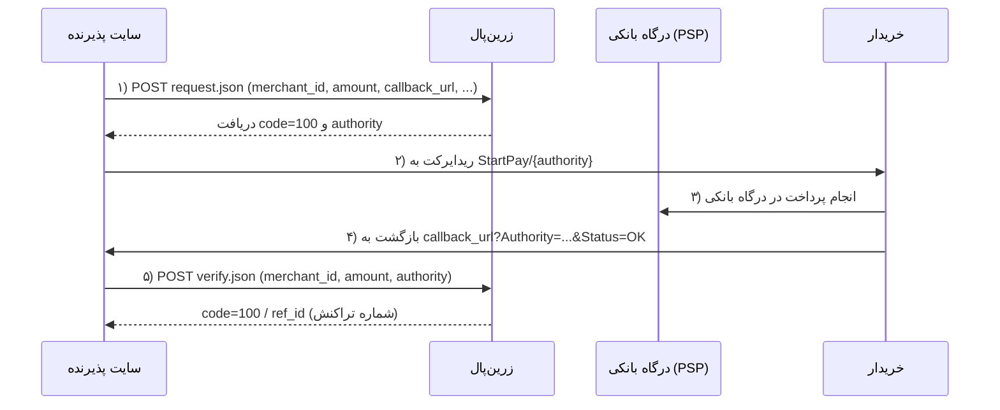

# مستندات کامل درگاه پرداخت زرین‌پال

> این سند، مجموعه مستندات رسمی درگاه پرداخت اینترنتی زرین‌پال را به‌صورت مرتب، کامل و یکجا جمع‌آوری کرده است. تمام محتوا بر اساس مستندات رسمی zarinpal.com تنظیم شده و شامل راهنمای اتصال، واحد پولی، میان‌پی (چک‌اوت)، اعتبارسنجی خودکار/غیرخودکار تراکنش، سرویس تست (Sandbox) و لیست کامل خطاهاست.

---

## فهرست مطالب

1. [معرفی](#۱-معرفی)
2. [چرخه کلی پرداخت](#۲-چرخه-کلی-پرداخت)
3. [راهنمای اتصال به درگاه](#۳-راهنمای-اتصال-به-درگاه)
4. [واحد پولی](#۴-واحد-پولی)
5. [میان‌پی (صفحه چک‌اوت) و ارسال سبد خرید](#۵-میان‌پی-صفحه-چک‌اوت-و-ارسال-سبد-خرید)
6. [اعتبارسنجی تراکنش (خودکار / غیرخودکار)](#۶-اعتبارسنجی-تراکنش-خودکار--غیرخودکار)
7. [سرویس تست (Sandbox)](#۷-سرویس-تست-sandbox)
8. [لیست خطاها](#۸-لیست-خطاها)
9. [جمع‌بندی نکات مهم](#۹-جمع‌بندی-نکات-مهم)

---

## ۱. معرفی

زرین‌پال یک درگاه پرداخت اینترنتی (Payment Gateway) است که به پذیرندگان اجازه می‌دهد بدون نیاز به قرارداد مستقیم با بانک‌ها، پرداخت‌های آنلاین خود را از طریق وب‌سرویس‌های ساده REST انجام دهند. پذیرنده با دریافت «مرچنت کد» (کد ۳۶ کاراکتری اختصاصی) از پنل زرین‌پال می‌تواند تراکنش ایجاد کند، خریدار را به صفحه پرداخت هدایت کند و در نهایت صحت پرداخت را با متد اعتبارسنجی (Verify) تایید کند.

بخش‌های اصلی مستندات زرین‌پال که در این سند پوشش داده شده‌اند عبارت‌اند از:

- **راهنمای اتصال به درگاه اینترنتی زرین‌پال** — چهار مرحله اصلی چرخه پرداخت
- **واحد پولی** — تعیین ریال (IRR) یا تومان (IRT)
- **میان‌پی (چک‌اوت)** — ارسال جزئیات سبد خرید با `cart_data`
- **اعتبارسنجی تراکنش (خودکار/غیرخودکار)** — کنترل رفتار Verify با `metadata.auto_verify`
- **سرویس تست (Sandbox)** — تست درگاه بدون پرداخت واقعی مبلغ
- **لیست خطاها** — تمام کدهای خطا به همراه توضیحات

نکته: تمامی داده‌های برگشتی از زرین‌پال به صورت JSON است.

---

## ۲. چرخه کلی پرداخت

جریان کامل پرداخت در زرین‌پال چهار مرحله دارد:



خلاصه مراحل:

1. **ارسال اطلاعات** — پذیرنده پارامترهای تراکنش را با متد `POST` به آدرس `payment/request.json` ارسال می‌کند و در پاسخ `authority` دریافت می‌کند.
2. **انتقال خریدار به صفحه پرداخت** — خریدار به آدرس `StartPay` به همراه `authority` هدایت می‌شود.
3. **بازگشت به وب‌سایت پذیرنده** — پس از پرداخت، خریدار به `callback_url` بازمی‌گردد و پارامترهای `Authority` و `Status` به‌صورت QueryString ارسال می‌شوند.
4. **اعتبارسنجی (Verify)** — پذیرنده صحت تراکنش را با فراخوانی متد `verify.json` تایید می‌کند و شماره تراکنش (`ref_id`) را دریافت می‌کند.

---

## ۳. راهنمای اتصال به درگاه

جهت استفاده از خدمات وب‌سرویس زرین‌پال باید از آدرس‌های وب‌سرویس، متدها و پارامترهای ذکر شده در این بخش استفاده نمایید.

### ۳.۱ مرحله اول: ارسال اطلاعات (Payment Request)

در مرحله اول پذیرندگان باید پارامترهای موجود در جدول زیر را، با توجه به نوع داده‌ها و نام فیلد، با متد `POST` به آدرس مشخص‌شده ارسال نمایند.

**آدرس وب‌سرویس:**

```
https://payment.zarinpal.com/pg/v4/payment/request.json
```

**پارامترهای درخواست:**

| نام | نوع | الزام | توضیحات |
| --- | --- | --- | --- |
| `merchant_id` | String | بله | کد ۳۶ کاراکتری اختصاصی پذیرنده |
| `amount` | Integer | بله | مبلغ تراکنش |
| `currency` | String | خیر | تعیین واحد پولی ریال (IRR) یا تومان (IRT) |
| `description` | String | بله | توضیحات مربوط به تراکنش |
| `callback_url` | String | بله | صفحه بازگشت مشتری، پس از انجام عمل پرداخت |
| `referrer_id` | String | خیر | کد معرف |
| `metadata` | Array | — | دارای مقادیر `mobile` و `email` و `order_id` |
| `mobile` | String | خیر | شماره تماس خریدار |
| `email` | String | خیر | ایمیل خریدار |
| `order_id` | String | خیر | شماره سفارش |

> **نکته:** تمامی داده‌های برگشتی از زرین‌پال به صورت JSON می‌باشد.

**نمونه درخواست (PHP):**

```php
<?php

$curl = curl_init();

curl_setopt_array($curl, array(
  CURLOPT_URL => 'https://payment.zarinpal.com/pg/v4/payment/request.json',
  CURLOPT_RETURNTRANSFER => true,
  CURLOPT_ENCODING => '',
  CURLOPT_MAXREDIRS => 10,
  CURLOPT_TIMEOUT => 0,
  CURLOPT_FOLLOWLOCATION => true,
  CURLOPT_HTTP_VERSION => CURL_HTTP_VERSION_1_1,
  CURLOPT_CUSTOMREQUEST => 'POST',
  CURLOPT_POSTFIELDS =>'{
  "merchant_id": "xxxxxxxx-xxxx-xxxx-xxxx-xxxxxxxxxxxx",
  "amount": "1100",
  "callback_url": "http://example.com/verify",
  "referrer_id": "xxxx",
  "description": "Transaction description.",
  "metadata": {
    "mobile": "09121234567",
    "email": "info.test@example.com"
  }
}',
  CURLOPT_HTTPHEADER => array(
    'Content-Type: application/json',
    'Accept: application/json'
  ),
));

$response = curl_exec($curl);

curl_close($curl);
echo $response;
```

**نمونه درخواست (cURL):**

```bash
curl -X POST \
  https://payment.zarinpal.com/pg/v4/payment/request.json \
  -H 'accept: application/json' \
  -H 'content-type: application/json' \
  -d '{
  "merchant_id": "xxxxxxxx-xxxx-xxxx-xxxx-xxxxxxxxxxxx",
  "amount": 1000,
  "callback_url": "http://your-site.com/verify",
  "referrer_id": "xxxx",
  "description": "Transaction description.",
  "metadata": {"mobile": "09121234567","email": "info.test@gmail.com"}
}'
```

**پاسخ موفق:**

```json
{
  "data": {
    "code": 100,
    "message": "Success",
    "authority": "A0000000000000000000000000000wwOGYpd",
    "fee_type": "Merchant",
    "fee": 100
  },
  "errors": []
}
```

در صورتی که در پاسخ دو مقدار `code` و `authority` را دریافت کرده باشید، می‌توانید به مرحله بعد (انتقال خریدار به صفحه پرداخت) بروید. مقدار `fee` کارمزد و `fee_type` پرداخت‌کننده کارمزد را نشان می‌دهد.

### ۳.۲ مرحله دوم: انتقال خریدار به صفحه پرداخت اینترنتی

در صورتی که در مرحله ارسال دیتای اولیه، اطلاعات ارسالی صحیح باشد و دو مقدار `code` و `authority` را دریافت کرده باشید، باید خریدار را به درگاه پرداخت انتقال دهید.

برای این منظور باید مقدار `authority` که در مرحله اول دریافت کرده‌اید را در انتهای آدرس قرار داده و خریدار را به URL ایجادشده ریدایرکت کنید تا خریدار بلافاصله به درگاه پرداخت اینترنتی هدایت شده و سپس مرحله بعد را انجام دهد:

```
Location: https://payment.zarinpal.com/pg/StartPay/ . $result['data']["authority"]
```

### ۳.۳ مرحله سوم: بازگشت به وب‌سایت پذیرنده

بعد از پایان عملیات در سمت زرین‌پال، خریدار از درگاه پرداخت اینترنتی باز می‌گردد. در این مرحله با توجه به نتیجه تراکنش و وضعیت آن، زرین‌پال خریدار را به آدرس درخواستی پذیرنده که در ارسال اطلاعات با پارامتر `callback_url` مشخص شده است، هدایت می‌کند:

```
http://www.yoursite.ir/?Authority=A0000000000000000000000000000wwOGYpd&Status=OK
```

> **نکته مهم:** یک `Status` به صورت QueryString به سایت پذیرنده ارسال می‌شود که دارای دو مقدار ثابت `OK` و `NOK` است. در صورتی که این مقدار برابر `NOK` باشد، به این معناست که تراکنش ناموفق بوده یا توسط خریدار لغو شده است؛ در نتیجه متد Verify باید **فقط در صورتی** استفاده شود که در QueryString مقدار `Status` برابر با `OK` باشد.

### ۳.۴ مرحله چهارم: اعتبارسنجی تراکنش (Verify)

برای استفاده از این متد، باید ابتدا در صفحه بازگشت، با استفاده از متد Verify اطلاعات ارسالی را چک کرده و در صورت موفق بودن پرداخت، آن را ثبت و شماره تراکنش را به کاربر نمایش دهید. در غیر این صورت موظف هستید با توجه به کد خطایی که توسط متد Verify دریافت می‌کنید، کاربر را از خطای رخ‌داده مطلع سازید.

در این مرحله اگر مقدار پارامتر `code` برابر `100` باشد به معنای موفق بودن تراکنش است و می‌توانید با پارامتر `ref_id` شماره تراکنش را به کاربر نمایش دهید.

**آدرس وب‌سرویس:**

```
https://payment.zarinpal.com/pg/v4/payment/verify.json
```

**پارامترهای درخواست:**

| نام | نوع | توضیحات |
| --- | --- | --- |
| `merchant_id` | String | کد ۳۶ کاراکتری اختصاصی پذیرنده |
| `amount` | Integer | مبلغ تراکنش به (ریال) |
| `authority` | String | کد یکتای شناسه مرجع درخواست |

**مقادیر برگشتی از متد Verify:**

| نام | نوع | توضیحات |
| --- | --- | --- |
| `code` | Integer | عددی که نشان‌دهنده موفق بودن یا موفق نبودن پرداخت است |
| `ref_id` | Integer | در صورتی که پرداخت موفق باشد، شماره تراکنش پرداخت انجام‌شده را برمی‌گرداند |
| `card_pan` | String | شماره کارت به صورت Mask |
| `card_hash` | String | هش کارت به صورت SHA256 |
| `fee_type` | String | پرداخت‌کننده کارمزد؛ که در پنل کاربری میان خریدار یا خود پذیرنده قابل انتخاب است |
| `fee` | Integer | کارمزد |

> **مهم:** در صورت موفقیت‌آمیز بودن تراکنش، با فراخوانی متد Verify، تنها یک‌بار کد `100` رخ می‌دهد و در دفعات بعدی Verifyِ همان تراکنش، کد `101` اتفاق می‌افتد. در نتیجه کد `101` به معنای آن است که تراکنش موفق بوده و یک‌بار قبلاً عملیات Verify روی آن انجام شده است. لطفاً در نظر داشته باشید که در دفعات بعدی Verifyِ همان تراکنش نیز کد `101` نشان داده می‌شود.

**نمونه درخواست (PHP):**

```php
<?php

$curl = curl_init();

curl_setopt_array($curl, array(
  CURLOPT_URL => 'https://payment.zarinpal.com/pg/v4/payment/verify.json',
  CURLOPT_RETURNTRANSFER => true,
  CURLOPT_ENCODING => '',
  CURLOPT_MAXREDIRS => 10,
  CURLOPT_TIMEOUT => 0,
  CURLOPT_FOLLOWLOCATION => true,
  CURLOPT_HTTP_VERSION => CURL_HTTP_VERSION_1_1,
  CURLOPT_CUSTOMREQUEST => 'POST',
  CURLOPT_POSTFIELDS =>'{
  "merchant_id": "xxxxxxxx-xxxx-xxxx-xxxx-xxxxxxxxxxxx",
  "amount": "1000",
  "authority": "A0000000000000000000000000000wwOGYpd"
}',
  CURLOPT_HTTPHEADER => array(
    'Content-Type: application/json',
    'Accept: application/json'
  ),
));

$response = curl_exec($curl);

curl_close($curl);
echo $response;
```

**نمونه درخواست (cURL):**

```bash
curl -X POST \
  https://payment.zarinpal.com/pg/v4/payment/verify.json \
  -H 'accept: application/json' \
  -H 'content-type: application/json' \
  -d '{
  "merchant_id": "xxxxxxxx-xxxx-xxxx-xxxx-xxxxxxxxxxxx",
  "amount": 1000,
  "authority": "A0000000000000000000000000000wwOGYpd"
}'
```

**پاسخ موفق:**

```json
{
  "data": {
    "code": 100,
    "message": "Verified",
    "card_hash": "1EBE3EBEBE35C7EC0F8D6EE4F2F859107A87822CA179BC9528767EA7B5489B69",
    "card_pan": "502229******5995",
    "ref_id": 201,
    "fee_type": "Merchant",
    "fee": 0
  },
  "errors": []
}
```

---

## ۴. واحد پولی

انتخاب واحد پولی، یکی دیگر از امکاناتی است که در اختیار توسعه‌دهنده‌ها قرار گرفته است. با استفاده از این امکان، می‌توانید به راحتی واحد پولی ارسالی را مشخص کرده و از ایجاد مشکلات احتمالی در تشخیص مبلغ ریال یا تومان برای خریدار جلوگیری کنید. برای استفاده از این امکان نیاز است تا در اطلاعات ارسالی پارامتر `currency` با یکی از مقدارهای `IRR` یا `IRT` همراه باشد:

- `IRR` — مقدار واحد پولی **ریال**
- `IRT` — مقدار واحد پولی **تومان**

**پارامترهای درخواست:**

| نام | نوع | الزام | توضیحات |
| --- | --- | --- | --- |
| `merchant_id` | String | بله | کد ۳۶ کاراکتری اختصاصی پذیرنده |
| `currency` | String | خیر | تعیین واحد پولی |
| `amount` | Integer | بله | مبلغ تراکنش |
| `description` | String | بله | توضیحات مربوط به تراکنش |
| `callback_url` | String | بله | صفحه بازگشت پذیرنده، پس از انجام عمل پرداخت |
| `referrer_id` | String | خیر | کد معرف |
| `metadata` | Array | — | — |
| `mobile` | String | خیر | شماره تماس خریدار |
| `email` | String | خیر | ایمیل خریدار |

> **نکته:** تمامی داده‌های برگشتی از زرین‌پال به صورت JSON می‌باشد.

**آدرس وب‌سرویس:**

```
https://payment.zarinpal.com/pg/v4/payment/request.json
```

**نمونه درخواست:**

```bash
curl -X POST \
  https://payment.zarinpal.com/pg/v4/payment/request.json \
  -H 'accept: application/json' \
  -H 'content-type: application/json' \
  -d '{
  "merchant_id": "xxxxxxxx-xxxx-xxxx-xxxx-xxxxxxxxxxxx",
  "currency": "IRT",
  "amount": 10000,
  "callback_url": "http://example.com/verify",
  "description": "افزایش اعتبار کاربر شماره ۱۱۳۴۶۲۹",
  "referrer_id": "xxxx",
  "metadata": {"mobile": "09121234567","email": "info.test@gmail.com"}
}'
```

**پاسخ:**

```json
{
  "data": {
    "code": 100,
    "message": "Success",
    "authority": "A0000000000000000000000000000wwOGXpd",
    "fee_type": "Merchant",
    "fee": 100
  },
  "errors": []
}
```

در نمونه درخواست بالا مقدار واحد پولی `IRT` (تومان) در نظر گرفته شده است؛ در نتیجه مقدار `amount` که معادل ۱۰,۰۰۰ است، در واحد تومان می‌باشد و مبلغ ۱۰,۰۰۰ تومان جهت پرداخت به درگاه ارسال می‌شود.

تمام مراحل دیگر (انتقال به درگاه، بازگشت و Verify) دقیقاً مانند بخش [راهنمای اتصال](#۳-راهنمای-اتصال-به-درگاه) است.

---

## ۵. میان‌پی (صفحه چک‌اوت) و ارسال سبد خرید

برای ارسال اطلاعات سبد خرید در هنگام ایجاد تراکنش می‌توانید از پارامتر اختیاری `cart_data` استفاده کنید. این Object درون بدنه JSON درخواست ساخت تراکنش تعریف می‌شود و شامل سه بخش مجزاست:

- `items` — آرایه‌ای از محصولات یا خدمات سفارش
- `added_costs` — هزینه‌های اضافی فاکتور
- `deductions` — کسرها یا تخفیف‌ها

استفاده از `cart_data` اختیاری است، اما توصیه می‌شود تا با درج آن، فرایند پرداخت برای خریدار شفاف‌تر شود.

### ۵.۱ بخش items (اقلام سفارش)

آرایه‌ای از محصولات یا خدمات سفارش:

| نام | نوع | الزام | توضیحات |
| --- | --- | --- | --- |
| `item_name` | String | بله | نام محصول یا خدمت |
| `item_amount` | String | بله | مبلغ هر واحد از کالا یا خدمت به ریال |
| `item_count` | String | بله | تعداد واحدهای مورد نظر از همان کالا یا خدمت |
| `item_amount_sum` | String | بله | مجموع مبلغ این کالا یا خدمت (حاصل‌ضرب `item_amount` در `item_count`). این مقدار را شما باید محاسبه و ارسال کنید |

### ۵.۲ بخش added_costs (هزینه‌های اضافی)

این object شامل هزینه‌های اضافی است که به فاکتور اضافه می‌شود. تمامی فیلدهای این بخش اختیاری هستند:

| نام | نوع | الزام | توضیحات |
| --- | --- | --- | --- |
| `tax` | String | خیر | مبلغ مالیات اعمال‌شده بر سبد خرید (ریال) |
| `payment` | String | خیر | کارمزد یا هزینه پرداخت (ریال) |
| `transport` | String | خیر | هزینه حمل و نقل یا ارسال (ریال) |

### ۵.۳ بخش deductions (کسرها و تخفیف‌ها)

این object برای ثبت کسرها یا تخفیف‌هاست. تمام فیلدهای این بخش نیز اختیاری هستند:

| نام | نوع | الزام | توضیحات |
| --- | --- | --- | --- |
| `discount` | String | خیر | مبلغ تخفیف که از مجموع سبد خرید کم می‌شود (ریال) |

### ۵.۴ نمونه کامل درخواست با سبد خرید

```bash
curl -X POST \
  https://payment.zarinpal.com/pg/v4/payment/request.json \
  -H 'accept: application/json' \
  -H 'content-type: application/json' \
  -d '{
  "merchant_id": "xxxxxxxx-xxxx-xxxx-xxxx-xxxxxxxxxxxx",
  "amount": 150000,
  "description": "پرداخت مربوط به سفارش شماره 1010 در فروشگاه تستی",
  "metadata": {
    "mobile": "09120000000",
    "email": "user@example.com",
    "order_id": "1234567890",
    "card_pan": "502229XXXXXX1234"
  },
  "cart_data": {
    "items": [
      {
        "item_name": "کفش ورزشی نایک",
        "item_amount": 50000,
        "item_count": 2,
        "item_amount_sum": 100000
      },
      {
        "item_name": "جوراب اسپرت",
        "item_amount": 25000,
        "item_count": 1,
        "item_amount_sum": 25000
      }
    ],
    "added_costs": {
      "tax": 5000,
      "payment": 1000,
      "transport": 2000
    },
    "deductions": {
      "discount": 3000
    }
  },
  "callback_url": "https://example.com/payment/verify"
}'
```

---

## ۶. اعتبارسنجی تراکنش (خودکار / غیرخودکار)

در چرخه‌ی پرداخت در زرین‌پال، پس از اینکه خریدار عملیات پرداخت را در درگاه بانکی انجام می‌دهد، زرین‌پال باید از بانک (PSP) استعلام و تأیید بگیرد تا از موفقیت نهایی تراکنش اطمینان حاصل شود. این مرحله را **اعتبارسنجی (Verify) نهایی تراکنش** می‌نامند.

تا زمانی که این اعتبارسنجی انجام نشود، پرداخت به‌صورت کامل انجام‌شده تلقی نمی‌شود و اگر این مرحله در بازه‌ی زمانی مقرر انجام نگیرد، مبلغ تراکنش به حساب خریدار بازگردانده خواهد شد.

در حالت عادی، این رفتار از طریق تنظیمات درگاه پرداخت در پنل زرین‌پال قابل کنترل است:

- اگر در پنل، **اعتبارسنجی خودکار** فعال باشد، زرین‌پال پس از پرداخت موفق، به‌صورت خودکار نزد بانک تراکنش را اعتبارسنجی می‌کند.
- اگر **اعتبارسنجی غیرخودکار** انتخاب شده باشد، آغاز فرآیند اعتبارسنجی به‌عهده‌ی پذیرنده است و باید با فراخوانی متد اعتبارسنجی تراکنش (متد `verify` در API پرداخت) این مرحله را آغاز کند.

برای کنترل دقیق‌تر این رفتار در لحظه‌ی پرداخت، می‌توانید از پارامتر اختیاری `auto_verify` در آبجکت `metadata` در بدنه‌ی درخواست پرداخت استفاده کنید.

### ۶.۱ موارد استفاده از metadata.auto_verify

این قابلیت زمانی کاربرد دارد که پذیرنده بخواهد رفتار اعتبارسنجی تراکنش را برای بعضی پرداخت‌ها مستقل از تنظیم کلی درگاه کنترل کند؛ مثلاً برای تراکنش‌های با مبلغ یا ریسک بالاتر، اعتبارسنجی غیرخودکار را اعمال کند یا برعکس، برخی پرداخت‌های روتین را خودکار اعتبارسنجی کند. همچنین در سناریوهایی که سایت پذیرنده ممکن است دچار اختلال شود یا خریدار به هر دلیل به آدرس کال‌بک نرسد، سپردن کنترل کامل اعتبارسنجی تراکنش به خود پذیرنده (از طریق `auto_verify=false` و فراخوانی متد اعتبارسنجی) کمک می‌کند از بروز مغایرت و اختلاف بین وضعیت پرداخت در سیستم پذیرنده و زرین‌پال جلوگیری شود.

> **نکته:** در صورت ارسال این پارامتر، مقدار `metadata.auto_verify` همواره نسبت به تنظیمات درگاه در پنل **اولویت دارد** و رفتار سیستم بر اساس همین مقدار تعیین می‌شود.

### ۶.۲ نمونه درخواست

```bash
curl -X POST \
  https://payment.zarinpal.com/pg/v4/payment/request.json \
  -H 'accept: application/json' \
  -H 'content-type: application/json' \
  -d '{
  "merchant_id": "xxxxxxxx-xxxx-xxxx-xxxx-xxxxxxxxxxxx",
  "currency": "IRT",
  "amount": 10000,
  "callback_url": "https://example.com/payment-callback",
  "description": "خرید اشتراک",
  "metadata": {
    "auto_verify": true,
    "mobile": "09121234567",
    "email": "info@example.com"
  }
}'
```

### ۶.۳ رفتار سیستم بر اساس مقدار metadata.auto_verify

رفتار سیستم در سه حالت مختلف:

#### حالت ۱: اگر مقدار `true` ارسال شود

- تراکنش پس از پرداخت موفق، به‌صورت خودکار توسط زرین‌پال نزد بانک اعتبارسنجی می‌شود.
- نیازی به فراخوانی متد اعتبارسنجی تراکنش از سمت پذیرنده نیست.
- این حالت معادل فعال‌بودن اعتبارسنجی خودکار است.
- حتی اگر در پنل، اعتبارسنجی خودکار غیرفعال باشد، با ارسال این مقدار، تراکنش به‌صورت خودکار اعتبارسنجی خواهد شد.

#### حالت ۲: اگر مقدار `false` ارسال شود

- در این حالت، اعتبارسنجی تراکنش به‌صورت خودکار انجام نمی‌شود و سیستم در هیچ مرحله‌ای بدون دخالت پذیرنده درخواست اعتبارسنجی به PSP ارسال نمی‌کند.
- زرین‌پال تنها زمانی اعتبارسنجی نهایی تراکنش را نزد PSP انجام می‌دهد که پذیرنده متد اعتبارسنجی تراکنش را فراخوانی کند.
- به‌عبارت دیگر، شروع فرآیند اعتبارسنجی نزد PSP وابسته به فراخوانی متد اعتبارسنجی تراکنش از طرف پذیرنده است؛ تا زمانی که این متد فراخوانی نشود، ارتباطی برای اعتبارسنجی با PSP برقرار نخواهد شد.
- اگر این فراخوانی در بازه‌ی زمانی مجاز انجام نشود، تراکنش نهایی نشده و مبلغ به حساب خریدار بازگردانده می‌شود.
- این حالت عملاً معادل انتخاب اعتبارسنجی غیرخودکار برای آن تراکنش است، حتی اگر در پنل درگاه، اعتبارسنجی خودکار فعال باشد.

#### حالت ۳: اگر پارامتر ارسال نشود

در صورتی که پارامتر `auto_verify` در آبجکت `metadata` ارسال نشود، رفتار سیستم بر اساس تنظیمات درگاه در پنل زرین‌پال تعیین می‌شود:

- اگر در پنل، اعتبارسنجی خودکار فعال باشد، تراکنش به‌صورت خودکار اعتبارسنجی می‌شود.
- اگر اعتبارسنجی خودکار غیرفعال باشد، پذیرنده باید متد اعتبارسنجی تراکنش را فراخوانی کند تا فرآیند Verify نزد PSP انجام شود.

### ۶.۴ نکات مهم

- استفاده از پارامتر `auto_verify` فقط در مواردی توصیه می‌شود که نیاز به کنترل لحظه‌ای رفتار اعتبارسنجی تراکنش وجود داشته باشد.
- در صورت عدم ارسال این پارامتر، رفتار سیستم کاملاً تابع تنظیمات درگاه شما در پنل زرین‌پال خواهد بود.
- در حالت اعتبارسنجی غیرخودکار، اگر متد اعتبارسنجی تراکنش از سمت پذیرنده در زمان مناسب فراخوانی نشود، پرداخت بازگشت خورده و عملاً از دست می‌رود.

---

## ۷. سرویس تست (Sandbox)

برای تست آزمایشی درگاه زرین‌پال بدون پرداخت مبلغ، فقط کافی است بعد از پیاده‌سازی درگاه، آدرس وب‌سرویس‌های مورد استفاده را به sandbox تغییر دهید:

```
https://payment.zarinpal.com/...
```

تغییر به:

```
https://sandbox.zarinpal.com/...
```

> **نکات:**
> - تمام `authority`های دریافت‌شده از سندباکس با حرف `S` شروع می‌شوند.
> - در سرویس تست (sandbox) برای قسمت مرچنت آیدی، یک رشته متنی UUID دلخواه وارد نمایید.

---

## ۸. لیست خطاها

خطاهایی که در زرین‌پال ممکن است رخ دهد به همراه توضیحات مربوطه در جدول زیر آمده است:

| type | code | EN | شرح فارسی |
| --- | --- | --- | --- |
| public | -9 | Validation error | خطای اعتبارسنجی: ۱- مرچنت کد داخل تنظیمات وارد نشده باشد. ۲- آدرس بازگشت (callback_url) وارد نشده باشد. ۳- توضیحات (description) وارد نشده باشد و یا از حد مجاز ۵۰۰ کاراکتر بیشتر باشد. ۴- مبلغ پرداختی کمتر یا بیشتر از حد مجاز. ۵- کد معرف (referrer_id) نامعتبر است. |
| public | -10 | Terminal is not valid, please check merchant_id or ip address. | IP یا مرچنت کد پذیرنده صحیح نیست. |
| public | -11 | Terminal is not active, please contact our support team. | مرچنت کد فعال نیست؛ پذیرنده مشکل خود را به امور مشتریان زرین‌پال ارجاع دهد. |
| public | -12 | Too many attempts, please try again later. | تلاش بیش از دفعات مجاز در یک بازه زمانی کوتاه؛ به امور مشتریان زرین‌پال اطلاع دهید. |
| public | -13 | Terminal limit reached. | خطای مربوط به محدودیت تراکنش. برای رفع این مورد نسبت به تکمیل مدارک خود با مراجعه به پشتیبانی اقدام نمایید. |
| public | -14 | The callback URL domain does not match the registered terminal domain. | کال‌بک URL با دامنه ثبت‌شده درگاه مغایرت دارد. |
| public | -15 | Terminal user is suspend (please contact our support team). | درگاه پرداخت به حالت تعلیق درآمده است؛ پذیرنده مشکل خود را به امور مشتریان زرین‌پال ارجاع دهد. |
| public | -16 | Terminal user level is not valid (please contact our support team). | سطح تایید پذیرنده پایین‌تر از سطح نقره‌ای است. |
| public | -17 | Terminal user level is not valid (please contact our support team). | محدودیت پذیرنده در سطح آبی. |
| public | -18 | The referrer address does not match the registered domain. | امکان استفاده از کد درگاه اختصاصی خود بر روی سایت یا جای دیگر را ندارید. |
| public | -19 | Terminal user transactions are banned. | امکان ایجاد تراکنش برای این ترمینال امکان‌پذیر نیست. |
| public | 100 | Success | عملیات موفق. |
| PaymentRequest | -40 | Invalid extra params, expire_in is not valid. | پارامترهای اضافی نامعتبر است. |
| PaymentRequest | -41 | Maximum amount is 100,000,000 tomans. | حداکثر مبلغ پرداختی ۱۰۰ میلیون تومان است. |
| PaymentVerify | -50 | Session is not valid, amounts values is not the same. | مبلغ پرداخت‌شده با مقدار مبلغ ارسالی در متد وریفای متفاوت است. |
| PaymentVerify | -51 | Session is not valid, session is not active paid try. | پرداخت ناموفق. |
| PaymentVerify | -52 | Oops!!, please contact our support team | خطای غیرمنتظره‌ای رخ داده است؛ پذیرنده مشکل خود را به امور مشتریان زرین‌پال ارجاع دهد. |
| PaymentVerify | -53 | Session is not this merchant_id session | پرداخت متعلق به این مرچنت کد نیست. |
| PaymentVerify | -54 | Invalid authority. | اتوریتی نامعتبر است. |
| PaymentVerify | -55 | Manual payment request not found. | تراکنش مورد نظر یافت نشد. |
| PaymentVerify | 101 | Verified | تراکنش وریفای شده است. |
| PaymentReverse | -60 | Session can not be reversed with bank. | امکان ریورس کردن تراکنش با بانک وجود ندارد. |
| PaymentReverse | -61 | Session is not in success status. | تراکنش موفق نیست یا قبلا ریورس شده است. |
| PaymentReverse | -62 | Terminal ip limit must be active. | IP درگاه ست نشده است. |
| PaymentReverse | -63 | Maximum time for reverse this session is expired. | حداکثر زمان (۳۰ دقیقه) برای ریورس کردن این تراکنش منقضی شده است. |

---

## ۹. جمع‌بندی نکات مهم

بر اساس مستندات رسمی، این نکات در پیاده‌سازی درگاه زرین‌پال اهمیت ویژه‌ای دارند:

1. **اعتبارسنجی (Verify) را همیشه انجام دهید** — تا زمانی که Verify انجام نشود، پرداخت کامل‌شده تلقی نمی‌شود؛ در غیر این صورت مبلغ در بازه زمانی مقرر به خریدار بازگردانده می‌شود.
2. **Status را بررسی کنید** — فراخوانی Verify فقط زمانی مجاز است که در بازگشت به `callback_url` مقدار `Status` برابر `OK` باشد؛ مقدار `NOK` به معنای ناموفق بودن یا لغو تراکنش است.
3. **کد ۱۰۱ را خطا تلقی نکنید** — کد `101` در Verify به معنای «تراکنش قبلاً با موفقیت وریفای شده» است و نشان‌دهنده موفق بودن پرداخت است.
4. **مبلغ Verify باید دقیقاً برابر مبلغ Request باشد** — در غیر این صورت با خطای `-50` مواجه می‌شوید.
5. **واحد پولی را صریح تعیین کنید** — با پارامتر `currency` (مقادیر `IRR` یا `IRT`) از ابهام ریال/تومان جلوگیری کنید.
6. **پیش از انتشار، با Sandbox تست کنید** — دامنه را به `sandbox.zarinpal.com` تغییر دهید، مرچنت را یک UUID دلخواه قرار دهید و توجه داشته باشید `authority`های سندباکس با حرف `S` شروع می‌شوند.
7. **دامنه callback_url باید با دامنه ثبت‌شده در پنل مطابقت داشته باشد** — در غیر این صورت با خطای `-14` مواجه می‌شوید.
8. **حداکثر مبلغ تراکنش ۱۰۰ میلیون تومان است** (خطای `-41`).
